# Diagrama de clases de diseño — UMBook (casos implementados)

**Versión:** 1.1 · **Última modificación:** 26/11/2026 · **Etapa:** Diseño

Diagrama de clases de diseño de **la implementación actual** (`4. Implementacion/codigo/`): **CU0001 Iniciar Sesión, CU0006 Registrar Usuario y CU0010 Invitación a la aplicación**. Responde al ítem "Diagrama de clases de diseño (con patrones)" que la cátedra marcó **FALTA** (observación D-03 de `docs/OBSERVACIONES_POR_ETAPA_UMBook.md`).

Cada clase, atributo y operación sale del código: si el código cambia, se corrige este `.md` y se regenera la imagen con `python3 docs/generar_diagramas.py "clases de diseño"`. **Si la imagen y este texto difieren, manda el texto.**

## Diagrama

```mermaid
---
config:
  layout: elk
  theme: redux-color
---
classDiagram
    direction TB

    namespace presentacion_Angular {
        class LoginComponent {
            +email: string
            +password: string
            +errorMessage: string
            +loading: boolean
            +login() void
            +goToRegister() void
        }
        class RegisterComponent {
            +name: string
            +email: string
            +password: string
            +errorMessage: string
            +successMessage: string
            +loading: boolean
            +register() void
            +goToLogin() void
        }
        class WelcomeComponent {
            +userName: string
            +goToInvite() void
            +goToLogin() void
        }
        class InviteComponent {
            +email: string
            +errorMessage: string
            +successMessage: string
            +loading: boolean
            +sendInvite() void
        }
        class AppComponent {
            +userInitial: string
            +logout() void
        }
    }

    namespace servicios_Angular {
        class AuthServiceFE["AuthService"] {
            <<Injectable>>
            -base: string
            +register(name, email, password) Observable
            +login(email, password) Observable~LoginResponse~
            +logout() void
            +getToken() string | null
            +getUserName() string
            +isAuthenticated() boolean
        }
        class API_URL {
            <<InjectionToken>>
            +environment.apiUrl: string
        }
        class NotificationServiceFE["NotificationService"] {
            <<Injectable>>
            -base: string
            +sendInvite(email) Observable
        }
        class LoginResponse {
            <<interface>>
            +access_token: string
            +user: id, name, email
        }
        class AuthGuard {
            +canActivate() boolean | UrlTree
        }
        class TokenInterceptor {
            +intercept(req, next) Observable~HttpEvent~
        }
        class CanActivate {
            <<interface>>
        }
        class HttpInterceptor {
            <<interface>>
        }
    }

    namespace controladores_Flask {
        class auth_controller {
            <<Blueprint /auth>>
            +register() Response
            +login() Response
        }
        class invite_controller {
            <<Blueprint /invite>>
            +invite(current_user: User) Response
        }
        class token_required {
            <<Decorator>>
            +token_required(fn) Callable
            -wrapper(*args, **kwargs) Response
        }
        class RegisterSchema {
            <<Schema>>
            +name: Str 1..128
            +email: Email max 255
            +password: Str min 8
        }
        class LoginSchema {
            <<Schema>>
            +email: Email
            +password: Str min 1
        }
        class InviteSchema {
            <<Schema>>
            +email: Email max 254
        }
    }

    namespace servicios_Flask {
        class AuthService {
            +register_user(name, email, password)$ User | None
            +authenticate(email, password)$ User | None
        }
        class InvitationService {
            +invite(inviter: User, email: str)$ Invitation
        }
        class NotificationService {
            <<Singleton>>
            -_instance: NotificationService$
            -_lock: threading.Lock$
            +#95;#95;new#95;#95;(cls) NotificationService
            +send_invitation(recipient_email, inviter_name) None
        }
    }

    namespace persistencia {
        class UserDAO {
            <<DAO>>
            +get_by_email(email)$ User | None
            +get_by_id(user_id)$ User | None
            +create(name, email, password_hash)$ User
        }
        class InvitationDAO {
            <<DAO>>
            +create(email, inviter_id)$ Invitation
            +update_status(invitation, status)$ Invitation
            +list_by_inviter(inviter_id)$ list~Invitation~
        }
        class User {
            <<entidad>>
            +id: int
            +name: str 128
            +email: str 255 unique
            +password_hash: str 255
            +created_at: datetime
        }
        class Invitation {
            <<entidad>>
            +PENDIENTE: str = 'pendiente'$
            +ENVIADA: str = 'enviada'$
            +FALLIDA: str = 'fallida'$
            +id: int
            +email: str 254
            +inviter_id: int
            +status: str
            +created_at: datetime
        }
    }

    %% Frontend
    LoginComponent --> AuthServiceFE : -auth
    RegisterComponent --> AuthServiceFE : -auth
    WelcomeComponent --> AuthServiceFE : -auth
    AppComponent --> AuthServiceFE : +auth
    InviteComponent --> NotificationServiceFE : -notif
    AuthGuard --> AuthServiceFE : -auth
    TokenInterceptor --> AuthServiceFE : -auth
    AuthGuard ..|> CanActivate
    TokenInterceptor ..|> HttpInterceptor
    AuthServiceFE ..> LoginResponse : devuelve
    AuthServiceFE ..> API_URL : dirección del backend
    NotificationServiceFE ..> API_URL : dirección del backend
    AuthGuard ..> WelcomeComponent : protege
    AuthGuard ..> InviteComponent : protege

    %% Frontend -> Backend (HTTP/JSON)
    AuthServiceFE ..> auth_controller : POST /auth/register, /auth/login
    NotificationServiceFE ..> invite_controller : POST /invite + Bearer

    %% Backend
    auth_controller ..> RegisterSchema : valida
    auth_controller ..> LoginSchema : valida
    auth_controller ..> AuthService
    invite_controller ..> InviteSchema : valida
    token_required ..> invite_controller : decora
    token_required ..> UserDAO : get_by_id
    invite_controller ..> InvitationService
    AuthService ..> UserDAO
    InvitationService ..> InvitationDAO
    InvitationService ..> NotificationService : send_invitation
    UserDAO ..> User : crea / consulta
    InvitationDAO ..> Invitation : crea / actualiza
    Invitation "0..*" --> "1" User : inviter
```

<!-- png: 3. Diseño/3_Diagramas de Clases/Diagrama de clases de diseño.png -->

## Capas (paquetes)

| Paquete | Dónde está en el código | Qué contiene |
|---|---|---|
| `presentacion_Angular` | `frontend/src/app/features/`, `app.component.ts` | Las pantallas de los tres casos: `LoginComponent` (CU0001), `RegisterComponent` (CU0006), `InviteComponent` (CU0010), `WelcomeComponent` (pantalla principal) y `AppComponent` (barra superior con cierre de sesión) |
| `servicios_Angular` | `frontend/src/app/core/` | `AuthService` (llama a `/auth` y guarda el token en `localStorage`), `NotificationService` (llama a `/invite`), `AuthGuard` (protege `/welcome` e `/invite`) y `TokenInterceptor` (agrega `Authorization: Bearer` y cierra la sesión ante un 401) |
| `controladores_Flask` | `backend/app/controllers/`, `backend/app/utils/decorators.py` | Los Blueprints `auth` e `invite`, los esquemas marshmallow que validan cada petición y el decorador `@token_required` |
| `servicios_Flask` | `backend/app/services/` | Las reglas de cada caso: `AuthService` (CU0001 y CU0006), `InvitationService` (CU0010) y `NotificationService` (envío del correo) |
| `persistencia` | `backend/app/persistence/` | Los DAO y las entidades SQLAlchemy `User` (tabla `users`) e `Invitation` (tabla `invitations`) |

El frontend se comunica con el backend solo por HTTP/JSON: las dos flechas punteadas `POST …` que cruzan de `servicios_Angular` a `controladores_Flask` son esas llamadas, no referencias entre clases.

## Patrones de diseño

| Patrón | Clase | Cómo está aplicado | Por qué |
|---|---|---|---|
| **Singleton** | `NotificationService` (backend) | `__new__` devuelve siempre la misma instancia, guardada en `_instance`; la creación se hace con doble verificación y un candado (`_lock: threading.Lock`), así dos hilos no crean dos instancias | Una sola instancia envía todos los correos de la aplicación. `InvitationService` hace `NotificationService()` y recibe siempre la misma |
| **DAO** (Data Access Object) | `UserDAO`, `InvitationDAO` | Métodos estáticos que encapsulan las consultas SQLAlchemy. Los servicios no tocan `db.session` | Separa las reglas del caso de uso de la base de datos. `UserDAO` además normaliza el correo (minúsculas, sin espacios) en un solo lugar |
| **Decorator** | `token_required` | Envuelve la función del endpoint (`wrapper`) y le agrega la verificación del JWT sin modificarla. Si el token es válido, le pasa el usuario como `current_user`; si no, responde 401 | La protección de un endpoint se agrega con una línea (`@token_required`) y la vista no se entera de cómo se valida la sesión |

Otros mecanismos que se ven en el diagrama, sin ser patrones del catálogo de la cátedra:

- **Blueprints** de Flask: agrupan los endpoints por caso de uso (`/auth`, `/invite`).
- **Inyección de dependencias** de Angular: los componentes reciben `AuthService` o `NotificationService` en el constructor; por eso las asociaciones llevan el nombre del atributo (`-auth`, `-notif`).

## Convenciones de la notación

- **Subrayado** (`$` en el Mermaid): atributo u operación estática. Los DAO y los servicios `AuthService` e `InvitationService` solo tienen métodos estáticos.
- `auth_controller`, `invite_controller` y `token_required` son **módulos o funciones de Python**, no clases. Se dibujan como clases con estereotipo («Blueprint», «Decorator») para mostrar sus operaciones y sus dependencias.
- «Schema» es un esquema de marshmallow. Sus atributos son los campos que valida, con sus límites (por ejemplo, `password: Str min 8`).
- `AuthService.register_user` y `AuthService.authenticate` devuelven el `User`, o `None` si no se pudo (correo ya registrado; credenciales incorrectas). Antes `register_user` devolvía una tupla (hallazgo H9).
- `AuthService.isAuthenticated()` (Angular) mira que haya token **y que no esté vencido**: lee el `exp` del JWT con la función `tokenVencido` del mismo archivo (hallazgo H6).
- `API_URL` es un `InjectionToken` de Angular cuyo valor sale de `src/environments/environment.ts`: la dirección del backend se configura en un solo lugar (hallazgo H10).
- Asociación (línea continua): una clase guarda una referencia a la otra. Dependencia (línea punteada): la usa sin guardarla. Realización (punteada con triángulo): implementa la interfaz.

## Qué queda fuera del diagrama

- `create_app()` (`backend/app/__init__.py`): arma la aplicación, inicializa las extensiones (`db`, `mail`, `jwt`, `migrate`) y registra los Blueprints.
- `Config` (`backend/app/config.py`): lee el `.env`.
- `MailConTimeout` (`backend/app/utils/mail.py`): la extensión Flask-Mail con timeout en la conexión SMTP, que usa `NotificationService` a través de `mail.send`.
- `AppModule` y las rutas de Angular (`app.module.ts`).
- La función `_normalizar(email)` de `user_dao.py`, que no pertenece a ninguna clase.

## Relación con los casos de uso

| Caso de uso | Recorrido por las clases |
|---|---|
| CU0001 Iniciar Sesión | `LoginComponent` → `AuthService` (Angular) → `auth_controller.login` + `LoginSchema` → `AuthService.authenticate` → `UserDAO.get_by_email` → `User` |
| CU0006 Registrar Usuario | `RegisterComponent` → `AuthService` (Angular) → `auth_controller.register` + `RegisterSchema` → `AuthService.register_user` → `UserDAO.get_by_email` / `create` → `User` |
| CU0010 Invitación a la aplicación | `InviteComponent` → `NotificationService` (Angular) → `TokenInterceptor` → `@token_required` → `invite_controller.invite` + `InviteSchema` → `InvitationService.invite` → `InvitationDAO.create` → `NotificationService.send_invitation` «Singleton» → `InvitationDAO.update_status` (`enviada` o `fallida`) |

---

## Control del documento

| Versión | Fecha | Etapa / Chat | Cambios |
|---|---|---|---|
| 1.0 | 26/11/2026 | Diseño | Versión inicial, a partir del código actual (CU0001, CU0006 y CU0010). Reemplaza al diagrama integral de la implementación anterior (amistad), que pasa a `_version_anterior/` |
| 1.1 | 26/11/2026 | Diseño | `API_URL` en los servicios de Angular (H10); `register_user` devuelve `User | None` (H9); `isAuthenticated()` mira el vencimiento (H6) |
