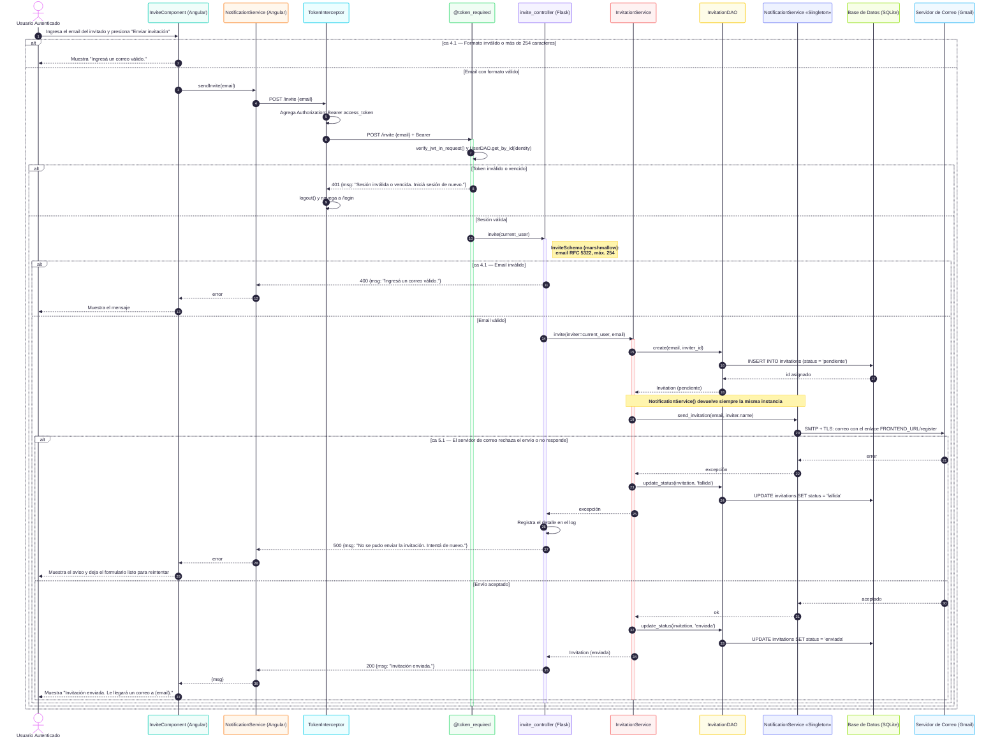

# CU0010 — Invitación a la aplicación — Diagrama de secuencia

**Versión:** 1.0 · **Última modificación:** 26/11/2026 · **Etapa:** Diseño

Curso normal y cursos alternativos de la ficha CU0010 (ca 4.1 y ca 5.1), más el caso de sesión vencida, con los nombres del código actual. Sigue la estética del diagrama de la compañera (`4. Implementacion/2_Diagramas de Secuencia/caso10-invitacion.png`) y corrige lo anotado en la observación I-03: el correo **se envía de verdad**, la invitación se guarda con su estado y están los caminos alternativos.

<!-- png: 3. Diseño/4_Diagramas de Secuencia/CU0010 - Invitación a la aplicación.png -->

## Notas

- **La invitación se guarda antes de enviar el correo** (Ob 1 de la ficha) y su estado cambia según el resultado: `pendiente` → `enviada`, o `pendiente` → `fallida`. El diagrama de estados está en `5_Diagramas de Estado/`.
- **Singleton:** `InvitationService` crea `NotificationService()` en cada invitación, pero `__new__` devuelve siempre la misma instancia. El diagrama de la compañera usaba `getInstance()`, que no existe en el código (I-03).
- **El envío es real:** Flask-Mail se conecta a Gmail por SMTP con TLS. Solo se simula si `MAIL_SUPPRESS_SEND=true` en el `.env` (sirve para probar sin credenciales).
- **Servidor de correo que no responde** (ca 5.1): la conexión SMTP espera como máximo `MAIL_TIMEOUT` segundos (5 por defecto) por operación; al vencer, el envío falla por el mismo camino del diagrama (mensajes 21 a 29).
- **Mensaje genérico ante el fallo** (ca 5.1): el detalle del error del servidor de correo queda en el log del backend y no llega al navegador.
- **Sesión vencida:** no es un curso alternativo de la ficha (la precondición pide sesión iniciada), pero el código lo maneja: `@token_required` responde 401 y `TokenInterceptor` cierra la sesión local y lleva a `/login`.
- **Rebotes:** si el correo rebota después de aceptado, el sistema no se entera (Ob 2 de la ficha).

---

## Control del documento

| Versión | Fecha | Etapa / Chat | Cambios |
|---|---|---|---|
| 1.0 | 26/11/2026 | Diseño | Versión inicial, a partir del código actual y la ficha CU0010, con la estética de los diagramas de la compañera |
