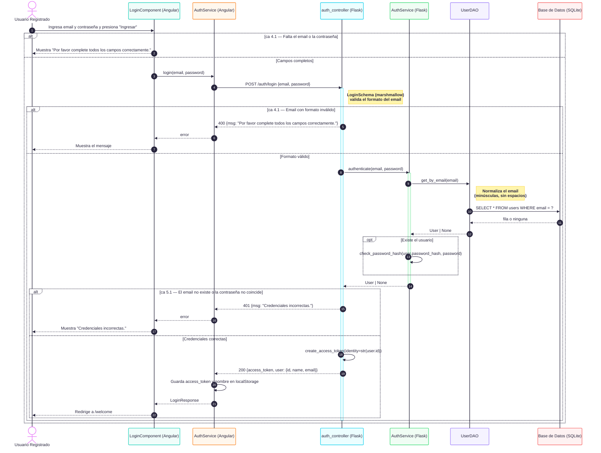

# CU0001 — Iniciar Sesión — Diagrama de secuencia

**Versión:** 2.0 · **Última modificación:** 26/11/2026 · **Etapa:** Diseño

Curso normal y cursos alternativos de la ficha CU0001 (ca 4.1 y ca 5.1), con los nombres del código actual. Sigue la estética de los diagramas de la compañera (`4. Implementacion/2_Diagramas de Secuencia/caso1-login.png`) y corrige lo anotado en la observación I-01: la contraseña se verifica **antes** de decidir la rama, dentro de `AuthService.authenticate`, y el token lo crea el controller.

<!-- png: 3. Diseño/4_Diagramas de Secuencia/CU0001 - Iniciar Sesión.png -->

## Notas

- **Un solo mensaje para los dos errores de credenciales** (ca 5.1, rnf 1.2): `authenticate` devuelve `None` tanto si el email no existe como si la contraseña no coincide, así la respuesta no revela qué correos están registrados.
- **La contraseña se verifica antes de decidir.** `check_password_hash` corre dentro de `authenticate`, que solo devuelve el usuario si la verificación da bien. En el diagrama de la compañera aparecía dentro de la rama "Credenciales válidas", es decir, después de haber decidido (I-01).
- **El token lo genera el controller**, no el servicio: `create_access_token` está en `auth_controller.login`. Dura 15 minutos (valor por defecto de Flask-JWT-Extended); ver el diagrama de estados de la sesión en `5_Diagramas de Estado/`.
- **Validación en dos lugares:** el navegador solo revisa que los campos no estén vacíos; el formato del email lo valida `LoginSchema` en el servidor. Los dos casos son el ca 4.1.

---

## Control del documento

| Versión | Fecha | Etapa / Chat | Cambios |
|---|---|---|---|
| 1.0 | 20/11/2026 | Diseño | Versión inicial, con los nombres de la implementación anterior |
| 2.0 | 26/11/2026 | Diseño | Rehecho con los nombres del código actual, numerado y con la estética de los diagramas de la compañera. Cursos alternativos con el código de la ficha (ca 4.1, ca 5.1) |
