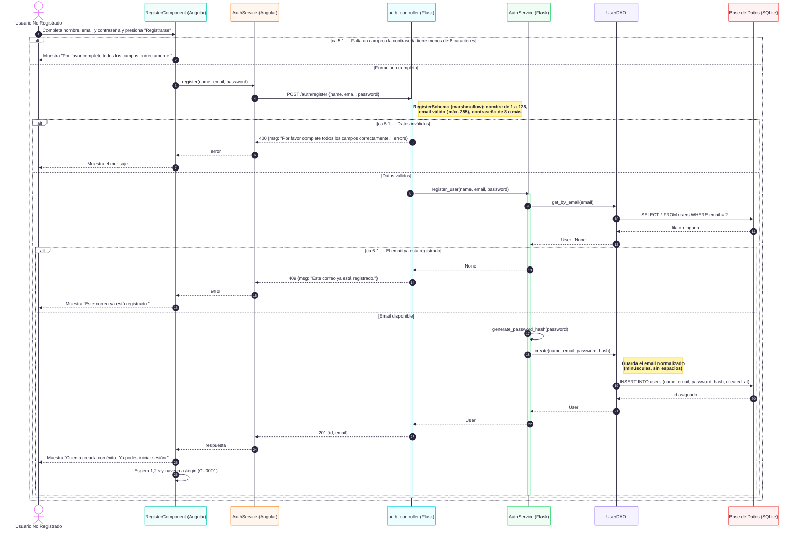

# CU0006 — Registrar Usuario — Diagrama de secuencia

**Versión:** 2.1 · **Última modificación:** 26/11/2026 · **Etapa:** Diseño

Curso normal y cursos alternativos de la ficha CU0006 (ca 5.1 y ca 6.1), con los nombres del código actual. Sigue la estética de los diagramas de la compañera (`4. Implementacion/2_Diagramas de Secuencia/caso6-registro.png`) y agrega lo que la observación I-02 marcaba como faltante: el camino de datos inválidos (400) y los mensajes reales de la pantalla.

<!-- png: 3. Diseño/4_Diagramas de Secuencia/CU0006 - Registrar Usuario.png -->

## Notas

- **Registro simultáneo con el mismo correo** (ca 6.1): si dos registros pasan a la vez la búsqueda del mensaje 9, la restricción única de la base rechaza el segundo en el `INSERT`; `UserDAO.create` deshace la transacción y devuelve `None`, y la respuesta es la misma rama de 409.
- **Email duplicado sin distinguir mayúsculas** (ca 6.1): `UserDAO` normaliza el email al buscar y al guardar, así `ana@x.com` y `ANA@X.COM` son la misma cuenta.
- **La contraseña se cifra en el servidor** con `generate_password_hash` (Werkzeug) dentro de `register_user`; la base nunca guarda la contraseña en texto plano (rnf 1.3).
- **No inicia sesión automáticamente:** después del registro el usuario va a la pantalla de inicio de sesión (paso 7 de la ficha).
- **Validación en dos lugares:** el navegador corta los campos vacíos y la contraseña corta; el servidor vuelve a validar todo con `RegisterSchema`. Los dos casos son el ca 5.1.
- `POST /auth/register` no lleva `@token_required`: por definición, el usuario todavía no tiene sesión.

---

## Control del documento

| Versión | Fecha | Etapa / Chat | Cambios |
|---|---|---|---|
| 1.0 | 20/11/2026 | Diseño | Versión inicial, con los nombres de la implementación anterior |
| 2.0 | 26/11/2026 | Diseño | Rehecho con los nombres del código actual, numerado y con la estética de los diagramas de la compañera. Cursos alternativos con el código de la ficha (ca 5.1, ca 6.1) |
| 2.1 | 26/11/2026 | Diseño | `register_user` devuelve `User` o `None` (H9); nota sobre el registro simultáneo (H8) |
