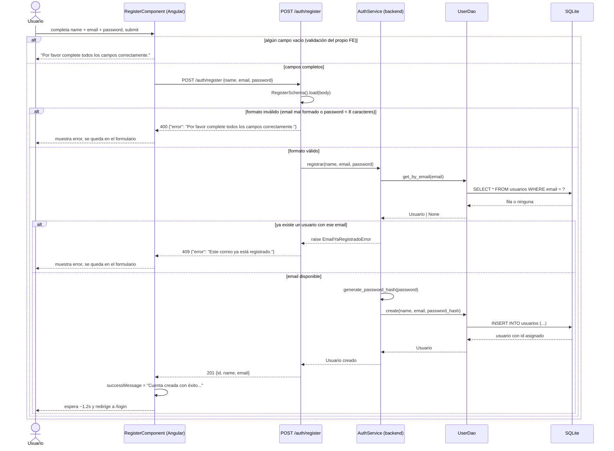

# CU0006 — Registrar Usuario — Diagrama de secuencia

CU0006. Curso normal + los dos alternativos: email ya registrado (409, lo
decide `AuthService`) y formato inválido (400, lo corta `RegisterSchema` de
marshmallow antes de tocar la base). El frontend nunca inicia sesión
automáticamente después de registrarse: muestra un mensaje de éxito y
redirige a `/login` para que el usuario entre con sus credenciales.

<!-- png: 3. Diseño/Diagramas de Secuencia/CU0006 - Registrar Usuario.png -->

**Por qué no hashea el frontend ni valida la password ahí:** el hash
(`generate_password_hash`, Werkzeug/PBKDF2) se calcula en `AuthService.registrar`,
nunca antes — la contraseña en texto plano solo viaja una vez, por HTTPS, del
formulario al backend. La regla de "mínimo 8 caracteres" vive en
`RegisterSchema` (backend), no en el FE: `RegisterComponent.submit()` sólo
chequea que los campos no estén vacíos, así que un password corto sí llega a
pegarle a la API y vuelve como 400 — no hay duplicación de la regla de
negocio en dos capas.

**Nota de autorización:** `POST /auth/register` es el único endpoint de
`auth_controller` sin `@token_required` (junto con `/auth/login`), porque por
definición todavía no existe un usuario autenticado en este flujo.
