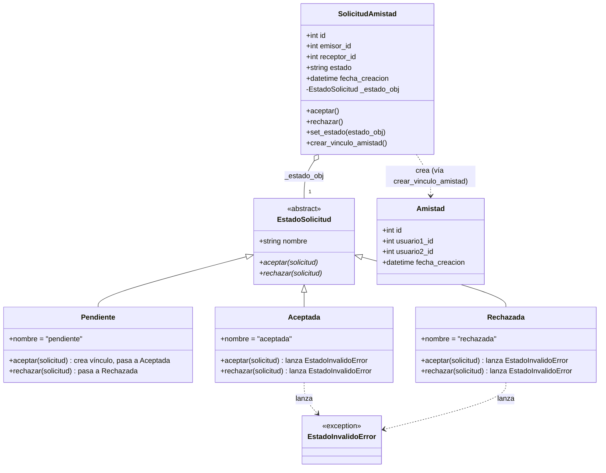

# Solicitar Amistad / Aceptar-Rechazar — Diagrama de clases (patrón State)

`SolicitudAmistad` es el **contexto** del patrón: `aceptar()`/`rechazar()` son una
línea cada una, delegan siempre en `_estado_obj`. Nunca decide ella misma si la
transición es válida — eso lo sabe cada estado. Código real en
[`estado_solicitud.py`](../../docs/backend.md) y `persistence/models.py`.

<!-- implementación anterior, no se regenera: _version_anterior/3. Diseño/3_Diagramas de Clases/Diagrama de clases - Patrón State.png -->

`estado` (string persistido) y `_estado_obj` (objeto State, no persistido) se
mantienen sincronizados: `_estado_obj` se reconstruye con `@reconstructor` cada
vez que SQLAlchemy carga la fila desde la DB, a partir del string guardado
(`estado_desde_nombre()`).
