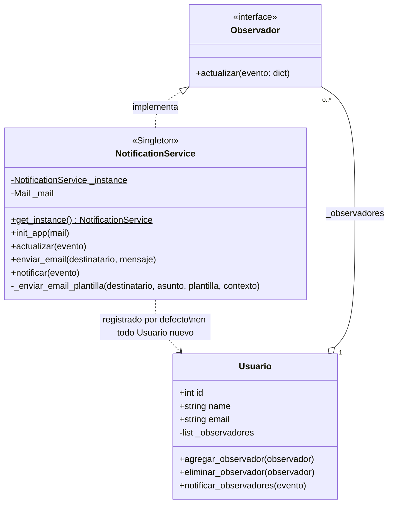

# Notificar Solicitud Recibida — Diagrama de clases (Observer + Singleton)

`Usuario` es el **Observable** (interfaz implícita: `agregar_observador` /
`eliminar_observador` / `notificar_observadores`). `NotificationService` implementa
`Observador` y es también el único Singleton del sistema — las dos cosas
conviven en la misma clase.

<!-- implementación anterior, no se regenera: _version_anterior/3. Diseño/3_Diagramas de Clases/Diagrama de clases - Observer y Singleton.png -->

**Por qué importa que sea Singleton acá:** todos los `Usuario` del sistema
terminan apuntando a la misma instancia de `NotificationService` como
observador — no se crea una instancia nueva por usuario. `get_instance()` usa
double-checked locking (`threading.Lock`) para que sea thread-safe si el server
llega a correr con varios workers.
