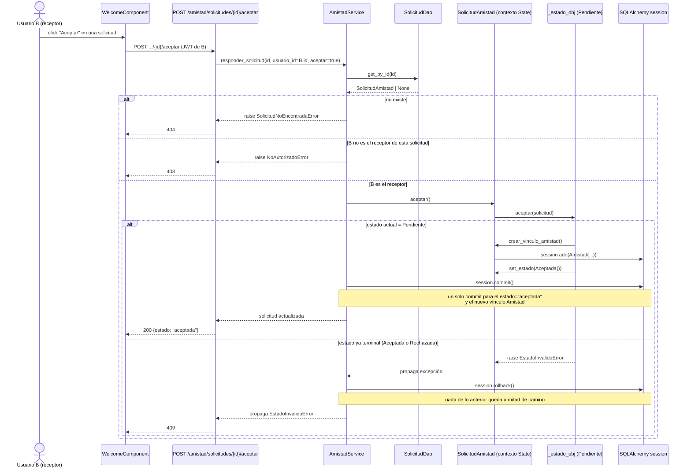

# CU0012 — Aceptar / Rechazar Solicitud — Diagrama de secuencia

Muestra las tres cosas que `PROMPT_CONSTRUCCION.md` pedía explícitas: la
autorización (solo el receptor puede responder), la delegación al patrón State, y
la transacción única (estado + vínculo `Amistad` se confirman o se revierten
juntos).

<!-- implementación anterior, no se regenera: _version_anterior/3. Diseño/4_Diagramas de Secuencia/CU0012 - Aceptar - Rechazar Solicitud.png -->

El flujo de **Rechazar** es el mismo diagrama reemplazando `aceptar()` por
`rechazar()`: no hay rama de `crear_vinculo_amistad()`, solo el cambio de estado a
`Rechazada` (o el mismo `EstadoInvalidoError` si ya estaba en un estado terminal).
