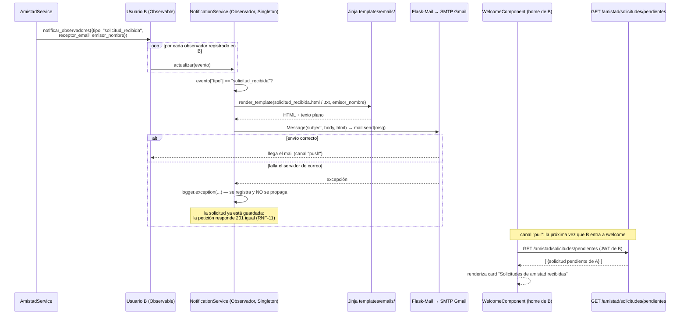

# CU0013 — Notificar Solicitud de Amistad Recibida — Diagrama de secuencia

Continúa exactamente donde termina
[`amistad-secuencia-solicitar.md`](./amistad-secuencia-solicitar.md): el punto
que hace válido el patrón es que `AmistadService` publica el evento en el
`Usuario` receptor y nunca llama al `NotificationService` directo.

<!-- implementación anterior, no se regenera: _version_anterior/3. Diseño/4_Diagramas de Secuencia/CU0013 - Notificar Solicitud Recibida.png -->

**No hay entidad `Notificacion` separada** (decisión documentada en
[`../proyecto.md`](../../docs/proyecto.md)): el mail es la notificación "push" en tiempo
real, y la lista de `solicitudes/pendientes` es la notificación "pull" que ve la
home — la misma consulta que ya usa el CU de Solicitar Amistad.

**Si el correo falla** (servidor SMTP caído, credenciales inválidas),
`NotificationService.actualizar()` registra el error en el log y no lo propaga:
la solicitud ya creada se conserva y el receptor la ve igual por el canal "pull"
(RNF-11, CU0013 ca 4.2).
