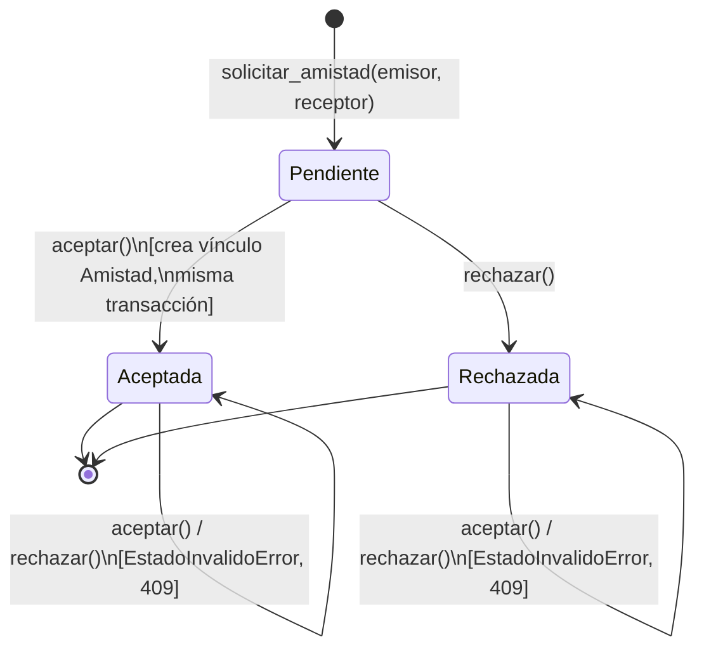

# SolicitudAmistad (CU0011 y CU0012) — Diagrama de estados

`Aceptada` y `Rechazada` son estados terminales: cualquier transición nueva desde
ahí es inválida (`EstadoInvalidoError`, 409 en la API). No hay forma de volver a
`Pendiente` ni de pasar de un estado terminal a otro.

<!-- implementación anterior, no se regenera -->

**Guardas que se evalúan antes de siquiera llegar a `Pendiente`** (en
`AmistadService.solicitar_amistad`, no en el patrón State — son reglas de
creación, no de transición): receptor debe existir, emisor ≠ receptor, no debe
existir ya una amistad confirmada, no debe haber ya una solicitud pendiente
entre los dos usuarios **en ningún sentido** (ni de A a B ni de B a A).

**Reenvío tras un rechazo:** como `Rechazada` es terminal, volver a solicitar
amistad no "reabre" la solicitud rechazada: crea una solicitud **nueva** en
`Pendiente`, y la rechazada queda como historial. La base lo permite porque la
unicidad es un índice parcial: una sola solicitud *pendiente* por par
emisor-receptor.
