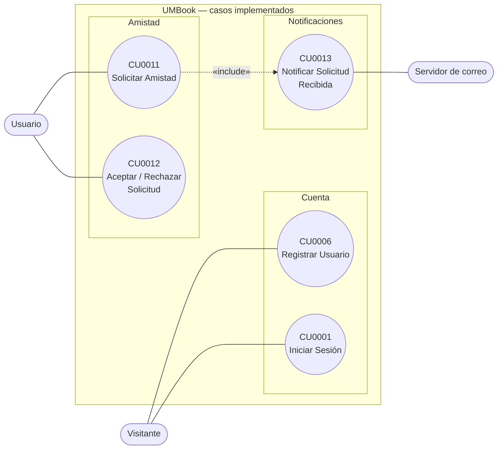

# CATÁLOGO DE CASOS DE USO — UMBook

**Versión:** 1.1 · **Última modificación:** 20/11/2026 · **Etapa:** Requisitos

> ⚠️ **Desactualizado respecto del código (25/11/2026).** La implementación de `4. Implementacion/` pasó a ser la del repositorio de una compañera del grupo: **CU0001 Iniciar Sesión, CU0006 Registrar Usuario y CU0010 Invitación**, con correcciones de seguridad y frontend nuevo (ver `4. Implementacion/README.md`). Este documento describe la implementación anterior (amistad y notificaciones: CU0011, CU0012 y CU0013), que ya no está en el código. Queda pendiente de realinear: ver `docs/tareas.md`.

Este documento fija **qué código tiene cada caso de uso implementado** y deja a la vista **dónde ese código choca** con otras fichas del repositorio. Los choques están marcados, no resueltos: resolverlos requiere acordarlo con el grupo.

---

## 1. Regla adoptada

Para los casos de uso que se implementaron, los códigos son **los que ya usan los procedimientos de prueba** (`5. Pruebas/2_Procedimientos de Prueba.docx`) y el listado `UMBook_RNF`. Registrar Usuario no figura en las pruebas; se le deja el `CU0006` que ya tenía en `docs/proyecto.md` y en el diagrama de secuencia de registro.

Las fichas de los demás integrantes del grupo **no se modificaron**.

| Marca | Significado |
|---|---|
| ⚠️ CHOQUE | El mismo código está asignado a otro caso de uso en otra ficha del repositorio |
| ✅ | El código no se repite en ningún otro lado |

---

## 2. Casos de uso implementados

| Código | Nombre | Paquete | Origen del código | Ficha | Estado del código |
|---|---|---|---|---|---|
| CU0001 | Iniciar Sesión | Gestión de Usuarios | Procedimientos de prueba | `CU0001_Iniciar_Sesión.docx` | ✅ |
| CU0006 | Registrar Usuario | Gestión de Usuarios | `docs/proyecto.md` | `CU0006_Registrar_Usuario.docx` | ⚠️ CHOQUE (1) |
| CU0011 | Solicitar Amistad | Gestión de Amistad | Procedimientos de prueba y `UMBook_RNF` | `CU0011_Solicitar_Amistad.docx` | ⚠️ CHOQUE (2) |
| CU0012 | Aceptar / Rechazar Solicitud de Amistad | Gestión de Amistad | Procedimientos de prueba | `CU0012_Aceptar_Rechazar_Solicitud.docx` | ⚠️ CHOQUE (3) |
| CU0013 | Notificar Solicitud de Amistad Recibida | Notificaciones | Procedimientos de prueba | `CU0013_Notificar_Solicitud_Recibida.docx` | ⚠️ CHOQUE (4) |

Las fichas nuevas están en `1. Requerimientos/4_Casos de Uso/`, y su texto fuente en [`ESPECIFICACIONES_CASOS_DE_USO_UMBook.md`](./ESPECIFICACIONES_CASOS_DE_USO_UMBook.md).

---

## 3. Los choques

### (1) CU0006 — Registrar Usuario

| Dónde | Qué dice |
|---|---|
| `docs/proyecto.md`, `docs/diagramas` (registro) | CU0006 = Registrar Usuario |
| `1. Requerimientos/4_Casos de Uso/CU0006.docx` | Plantilla **vacía** ("Nombre Caso de Uso"), a nombre de Alexis Martin Yassuff |

### (2) CU0011 — Solicitar Amistad

| Dónde | Qué dice |
|---|---|
| Procedimientos de prueba, `UMBook_RNF` | CU0011 = Solicitar Amistad |
| `CASO DE USO CU0011 – MOSTRAR USUARIOS CON AMIGOS EN COMÚN.docx` | CU0011 = Mostrar usuarios con amigos en común (Victor Gimenez) |
| `CU0011.docx` | CU0011 = Eliminar comentarios (Juan Pablo Samsó) |
| `CU-7-11-23.pdf` | Rotula "CUU011" el caso de amigos en común |

Es el choque más fuerte: **tres significados** y uno de ellos es un caso tuyo ya rotulado en el diagrama general del grupo.

### (3) CU0012 — Aceptar / Rechazar Solicitud de Amistad

| Dónde | Qué dice |
|---|---|
| Procedimientos de prueba | CU0012 = Aceptar / Rechazar |
| `CU0002.docx` | La **ficha del grupo** de Aceptar / Rechazar tiene el código CU0002 (Magdalena Maluff) |
| `CU0012.docx` | CU0012 = Crear grupos de amigos (Samsó) |
| `CU0012 - Eliminar amigos.docx` | CU0012 = Eliminar amigos (Adriano Tisera) |

Acá hay además una **ficha duplicada**: el mismo caso de uso existe como `CU0002.docx` (ficha del grupo) y como `CU0012_Aceptar_Rechazar_Solicitud.docx` (la nueva).

### (4) CU0013 — Notificar Solicitud de Amistad Recibida

| Dónde | Qué dice |
|---|---|
| Procedimientos de prueba | CU0013 = Notificar Solicitud de Amistad Recibida |
| `UMBook_RNF` (RNF-01) | "la consulta de amigos en común … (depende de CU0013)": ahí CU0013 sería el caso de amigos en común |

No hay ninguna ficha `CU0013`.

---

## 4. Todas las fichas que hay en `1. Requerimientos/4_Casos de Uso/`

| Archivo | Código | Nombre | Autor | Marca |
|---|---|---|---|---|
| `CU0001_Iniciar_Sesión.docx` | CU0001 | Iniciar Sesión | Victor Gimenez | ✅ |
| `CU0002.docx` | CU0002 | Aceptar / Rechazar solicitud de amistad | Magdalena Maluff | Duplica a CU0012 (3) |
| `CU0003.docx` | CU0003 | Gestionar usuarios, comentarios y fotos | Magdalena Maluff | ✅ |
| `CU0004.docx` | CU0004 | Publicar en el Muro | Alexis Martin Yassuff | ✅ |
| `CU0005 - Buscar usuarios.docx` | CU0005 | Buscar Usuarios | Adriano Tisera | ⚠️ dos fichas con CU0005 |
| `CU0005.docx` | CU0005 | *(plantilla vacía)* | Alexis Martin Yassuff | ⚠️ dos fichas con CU0005 |
| `CU0006.docx` | CU0006 | *(plantilla vacía)* | Alexis Martin Yassuff | ⚠️ (1) |
| `CU0006_Registrar_Usuario.docx` | CU0006 | Registrar Usuario | Victor Gimenez | ⚠️ (1) |
| `CU0007.docx` | CU0007 | Gestionar Álbum | Facundo Mala | ⚠️ dos fichas con CU0007 |
| `CASO DE USO CU0007 – COMENTAR PUBLICACIÓN.docx` | CU0007 | Comentar Publicaciones | Victor Gimenez | ⚠️ dos fichas con CU0007 |
| `CU0008.docx` | CU0008 | Gestionar Comentarios | Facundo Mala | ✅ |
| `CU0009.docx` | CU0009 | *(plantilla vacía)* | Facundo Mala | ✅ |
| `CU0010.docx` | CU0010 | Invitación a la aplicación | Juan Pablo Samsó | ✅ (fuera de alcance) |
| `CU0011.docx` | CU0011 | Eliminar comentarios | Juan Pablo Samsó | ⚠️ (2) |
| `CASO DE USO CU0011 – MOSTRAR USUARIOS CON AMIGOS EN COMÚN.docx` | CU0011 | Mostrar usuarios con amigos en común | Victor Gimenez | ⚠️ (2) |
| `CU0011_Solicitar_Amistad.docx` | CU0011 | Solicitar Amistad | Victor Gimenez | ⚠️ (2) |
| `CU0012.docx` | CU0012 | Crear grupos de amigos | Juan Pablo Samsó | ⚠️ (3) |
| `CU0012 - Eliminar amigos.docx` | CU0012 | Eliminar Amigos | Adriano Tisera | ⚠️ (3) |
| `CU0012_Aceptar_Rechazar_Solicitud.docx` | CU0012 | Aceptar / Rechazar Solicitud de Amistad | Victor Gimenez | ⚠️ (3) |
| `CU0013_Notificar_Solicitud_Recibida.docx` | CU0013 | Notificar Solicitud de Amistad Recibida | Victor Gimenez | ⚠️ (4) |
| `CU0017 - Gestión de permisos en el sitio del usuario.docx` | CU0017 | Gestión de permisos en el sitio del usuario | Adriano Tisera | ✅ |
| `CASO DE USO CU0023 – Envió de Mails para Notificar Cumpleaños Cercanos.docx` | CU0023 | Enviar notificación de cumpleaños cercanos por email | Victor Gimenez | ✅ |

Además están los PDF generales `0-CU_General.pdf` (diagrama de casos de uso del grupo, **sin códigos**) y `CU-7-11-23.pdf` (diagramas de tus tres casos: "CUU007", "CUU011" y "CUU023").

---

## 5. Qué hay que decidir para cerrar los choques

1. **CU0011:** ¿Solicitar Amistad conserva el código y "Mostrar usuarios con amigos en común" (tuyo) y "Eliminar comentarios" cambian? ¿O al revés?
2. **CU0012:** ¿se descarta `CU0002.docx` en favor de la ficha nueva, o se renumera la nueva a `CU0002`? Hoy el caso está duplicado.
3. **CU0006:** ¿Registrar Usuario ocupa el número que Yassuff dejó como plantilla vacía, o toma uno libre?
4. **CU0013:** hay que fijar a cuál de los dos casos pertenece.
5. **CU0005 y CU0007:** dos fichas con el mismo código dentro del grupo; no afectan a los casos implementados, pero conviene avisar al grupo.

Cuando se decida, el cambio de código es mecánico: hay que tocar este catálogo, las fichas, los diagramas (`CUxxxx - …png`) y los procedimientos de prueba.

---

## 6. Diagrama de casos de uso de lo implementado

La cátedra pide **un solo diagrama de casos de uso para toda la aplicación**. Ese diagrama es `1. Requerimientos/3_Diagrama de Casos de Uso/0-CU_General.pdf`, del grupo: cubre todos los casos de uso, pero **no lleva códigos** y repite "Gestionar álbum" y "Comentar foto" en dos paquetes. Este diagrama complementario muestra solo el alcance implementado, **con los códigos de este catálogo**.

<!-- png: 1. Requerimientos/3_Diagrama de Casos de Uso/Diagrama de Casos de Uso - Implementados.png -->

---

## Control del documento

| Versión | Fecha | Etapa / Chat | Cambios |
|---|---|---|---|
| 1.0 | 20/11/2026 | Requisitos | Versión inicial. Códigos tomados de los procedimientos de prueba, con los choques marcados |
| 1.1 | 20/11/2026 | Requisitos | Se agrega el diagrama de casos de uso de lo implementado, con códigos, y la observación sobre `0-CU_General.pdf` |
