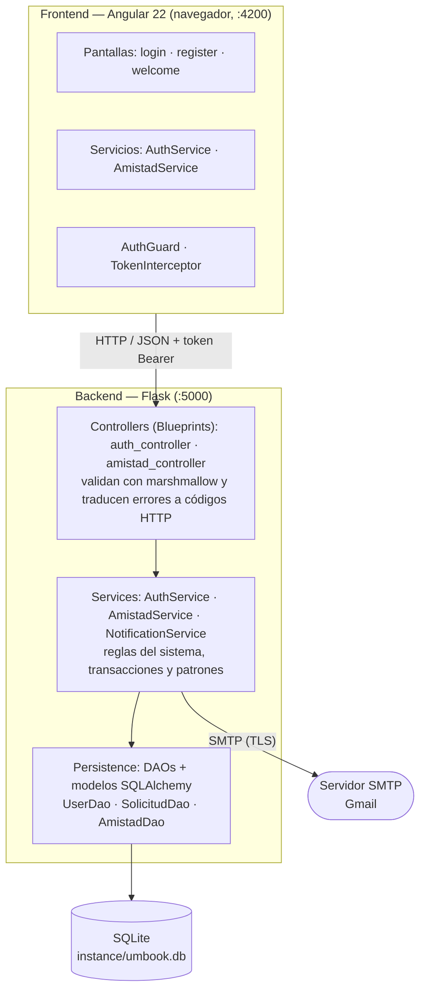
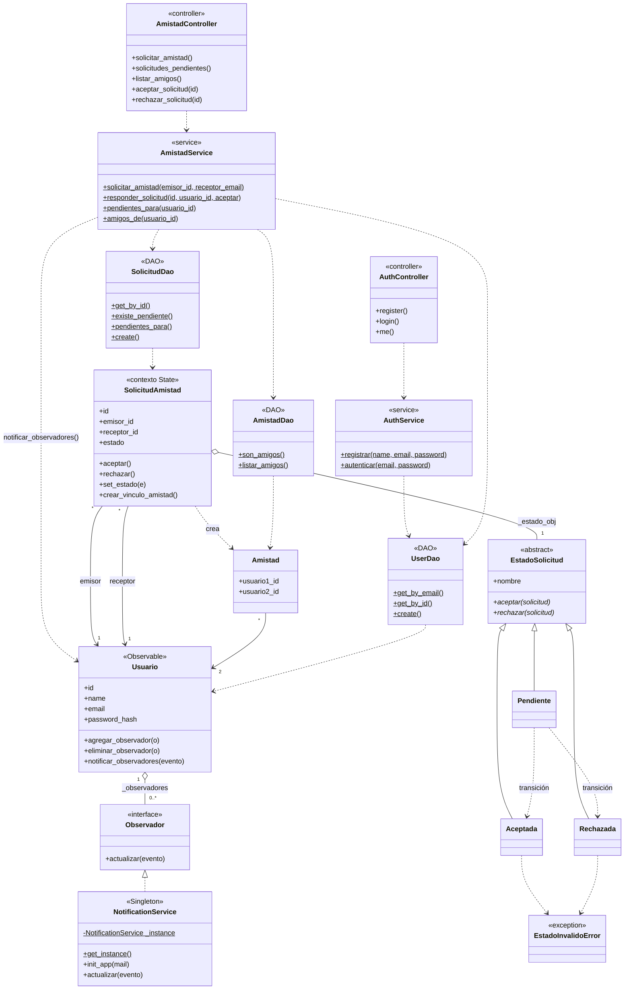

# DISEÑO — UMBook (casos implementados)

**Versión:** 1.3 · **Última modificación:** 26/11/2026 · **Etapa:** Diseño

> ⚠️ **Desactualizado respecto del código (25/11/2026).** La implementación de `4. Implementacion/` pasó a ser la del repositorio de una compañera del grupo: **CU0001 Iniciar Sesión, CU0006 Registrar Usuario y CU0010 Invitación**, con correcciones de seguridad y frontend nuevo (ver `4. Implementacion/README.md`). Este documento describe la implementación anterior (amistad y notificaciones: CU0011, CU0012 y CU0013), que ya no está en el código. Queda pendiente de realinear: ver `docs/tareas.md`.

Diseño de los cinco casos de uso implementados (CU0001, CU0006, CU0011, CU0012 y CU0013), tal como quedó **en el código**. Los diagramas están en Mermaid dentro de este documento y de los archivos de `3. Diseño/Diagramas de …/`, que son la fuente. Las imágenes `.png` se generan con `docs/generar_diagramas.py`. **Si el `.png` y el texto difieren, manda el texto.**

> **Sobre `Diseño de Arquitectura - UMBook.docx`.** Es la propuesta de arquitectura original del grupo y describe un sistema más grande que el que se implementó (Spring, FastAPI, Android e iOS, JDBC, y los patrones Composite, Factory Method y Strategy). Para los casos implementados **manda este documento**; la §8 lista las diferencias.

---

## 1. Arquitectura en capas

<!-- sin entregable: el grupo no lo entrega; el Mermaid queda como fuente -->

| Capa | Responsabilidad | Regla |
|---|---|---|
| Controllers | Validar el pedido, llamar a un service y devolver la respuesta con su código | No contienen reglas del sistema |
| Services | Reglas del sistema, patrones State y Observer, `commit` y `rollback` | No conocen HTTP |
| Persistence | Consultas y modelos | No contienen reglas |

`create_app()` (`app/__init__.py`) es el único lugar que arma las piezas: configuración, extensiones y blueprints.

---

## 2. Estructura del código

Las rutas son relativas a `4. Implementacion/codigo/backend/`.

| Ruta | Contiene |
|---|---|
| `run.py` | Punto de entrada: crea la app, las tablas y arranca el servidor |
| `app/config.py` | Única fuente de configuración (lee `.env`) |
| `app/extensions.py` | Instancias de SQLAlchemy, Migrate, JWT, Mail y CORS |
| `app/controllers/` | `auth_controller.py`, `amistad_controller.py` |
| `app/services/` | `auth_service.py`, `amistad_service.py`, `notification_service.py`, `observer.py`, `estados/estado_solicitud.py` |
| `app/persistence/` | `models.py` y `daos/` (`user_dao.py`, `solicitud_dao.py`) |
| `app/templates/emails/` | Plantillas del correo (HTML y texto) |
| `app/utils/decorators.py` | `@token_required` |
| `tests/` | 39 pruebas de pytest |

| Endpoint | Caso de uso |
|---|---|
| `POST /auth/login` | CU0001 |
| `POST /auth/register` | CU0006 |
| `POST /amistad/solicitudes` | CU0011 (dispara CU0013) |
| `GET /amistad/solicitudes/pendientes` | CU0012 (paso 1) y CU0013 (paso 5) |
| `POST /amistad/solicitudes/<id>/aceptar` · `…/rechazar` | CU0012 |
| `GET /amistad/amigos`, `GET /auth/me` | Apoyo de la pantalla principal |

---

## 3. Mecanismos de diseño

| Mecanismo | Cómo se resuelve | Requisito |
|---|---|---|
| Autenticación | Token JWT firmado con `JWT_SECRET_KEY`; `@token_required` lo valida y deja el usuario en `g.current_user` | RNF-16 |
| Almacenamiento de claves | `generate_password_hash` / `check_password_hash` (Werkzeug) | RNF-08 |
| Validación de entrada | Esquemas de marshmallow en los controllers | RNF-14 |
| Persistencia | Flask-SQLAlchemy sobre SQLite | RNF-06 |
| Integridad | Restricciones únicas: correo, par emisor-receptor, par de amigos | RNF-15 |
| Transacciones | `db.session.commit()` único en `responder_solicitud`, con `rollback` ante cualquier excepción | RNF-12 |
| Correo | Flask-Mail, plantillas Jinja en HTML y texto; `MAIL_SUPPRESS_SEND` para pruebas | RNF-02 |
| Configuración | Variables de entorno (`.env`, fuera del repositorio) | RNF-18 |
| CORS | Flask-Cors, con `CORS_ORIGIN` configurable | — |
| Errores | Cada excepción del dominio se traduce a un código HTTP en el controller | ver tabla siguiente |
| Sesión en el cliente | `TokenInterceptor` cierra la sesión ante 401 o 422; `AuthGuard` protege la pantalla principal | RNF-10, RNF-16 |

| Excepción | Código | Dónde |
|---|---|---|
| Validación de marshmallow | 400 | Todos los endpoints con cuerpo |
| `CredencialesInvalidasError` | 401 | login |
| `NoAutorizadoError` | 403 | aceptar / rechazar |
| `UsuarioNoEncontradoError`, `SolicitudNoEncontradaError` | 404 | solicitar, aceptar / rechazar |
| `EmailYaRegistradoError`, `SolicitudInvalidaError`, `EstadoInvalidoError` | 409 | registro, solicitar, aceptar / rechazar |

---

## 4. Diagrama de clases de diseño (integral)

> **Implementación anterior.** El diagrama de clases de diseño vigente, hecho a partir del código actual (CU0001, CU0006 y CU0010, con Singleton, DAO y Decorator), está en [`3. Diseño/3_Diagramas de Clases/diseno-clases.md`](../3.%20Diseño/3_Diagramas%20de%20Clases/diseno-clases.md). El de abajo es el de amistad: su imagen y los diagramas parciales (State, Observer y Singleton) están en `_version_anterior/3. Diseño/3_Diagramas de Clases/`.

<!-- implementación anterior, no se regenera: _version_anterior/3. Diseño/3_Diagramas de Clases/Diagrama de clases de diseño (amistad).png -->

### Dónde está cada patrón

| Patrón | Clases | Qué resuelve |
|---|---|---|
| **State** | `SolicitudAmistad` (contexto), `EstadoSolicitud`, `Pendiente`, `Aceptada`, `Rechazada` | Que cada estado decida qué transiciones admite. `aceptar()` y `rechazar()` de la solicitud solo delegan. Agregar un estado no obliga a tocar el servicio. |
| **Observer** | `Usuario` (observable), `Observador` | Que `AmistadService` avise de la solicitud sin conocer a quien reacciona. |
| **Singleton** | `NotificationService` | Una sola instancia del notificador, con doble verificación y candado. |

### Lo que conviene poder explicar

- **`Usuario` ↔ `NotificationService`:** el modelo registra al notificador como observador por defecto y lo importa dentro del método, no al principio del archivo, para evitar un import circular entre modelos y servicios.
- **`estado` y `_estado_obj`:** el primero es el texto que se guarda en la base; el segundo es el objeto State, que no se guarda y se reconstruye al cargar la fila.
- **Orden canónico de `Amistad`:** el id menor va primero, para que la restricción única y `son_amigos()` no dependan de quién envió la solicitud.
- **Unicidad de `SolicitudAmistad`:** es un índice único **parcial** (`uq_solicitud_pendiente_par`, solo sobre las filas con estado `pendiente`). Garantiza en la base una sola solicitud pendiente por par emisor-receptor y deja guardar las rechazadas y aceptadas como historial, así se puede volver a solicitar tras un rechazo sin reabrir un estado terminal. El sentido inverso (solicitud cruzada) lo controla `AmistadService` con un segundo `existe_pendiente(receptor, emisor)`.
- **Falla del correo:** `NotificationService.actualizar()` atrapa cualquier error del envío, lo registra con el logger de Flask y no lo propaga. El aviso por correo es adicional; la solicitud no depende de él (RNF-11).

---

## 5. Diagrama de despliegue

`3. Diseño/1_Diagrama de Despliegue.png` (y `.svg`), generado con `docs/generar_despliegue_subsistemas.py`. Mantiene la forma del diagrama del grupo (nodos en 3D con sus componentes, hecho originalmente en PlantUML) con el contenido del código actual. El original está en `_version_anterior/3. Diseño/`.

| Nodo | Componente | Qué hay en el código |
|---|---|---|
| Equipo local (127.0.0.1) | — | Agrupa los tres nodos locales: es un despliegue de **demostración**, todo en el mismo equipo. `run.py` hace que Flask escuche solo en `127.0.0.1` |
| Cliente Web | Navegador web · SPA Angular 22 | La aplicación Angular; el token de sesión queda en `localStorage` |
| Servidor Frontend | Node.js · `ng serve`, puerto 4200 | Servidor de desarrollo de Angular. `CORS_ORIGIN` y `FRONTEND_URL` apuntan a `http://localhost:4200` |
| Servidor Backend | Flask 3 · Python 3, API REST en el puerto 5000 · SQLite `instance/umbook.db` | Blueprints `/auth` e `/invite`. La base es un archivo dentro del mismo nodo, al que se accede con SQLAlchemy (no hay servidor de base de datos) |
| Servidor de Correo | Gmail (SMTP), `smtp.gmail.com:587` | Externo. Flask-Mail se conecta con TLS (`MAIL_USE_TLS=true`) y una *app password* del `.env` |

| Comunicación | Protocolo |
|---|---|
| Navegador → Servidor Frontend | HTTP: descarga la SPA |
| Navegador → Servidor Backend | HTTP / JSON, con `Authorization: Bearer <JWT>` en `/invite` |
| Flask → SQLite | SQLAlchemy (archivo local) |
| Flask → Gmail | SMTP + TLS (Flask-Mail) |

**Diferencias con el diagrama del grupo:** el backend es Flask, no Spring Boot; la base es SQLite por SQLAlchemy, no PostgreSQL/MySQL por JDBC; se agrega el nodo del frontend Angular, y la comunicación con el navegador es **HTTP**, no HTTPS (RNF-10 figura como no cumplido).

---

## 6. Diagrama de subsistemas

`3. Diseño/2_Diagrama de Subsistemas.png` (y `.svg`), generado con `docs/generar_despliegue_subsistemas.py`. Mantiene las cuatro capas y la forma del diagrama del grupo; el original está en `_version_anterior/3. Diseño/`.

| Capa | Subsistemas | Relación con el código |
|---|---|---|
| Aplicación Específica | **Gestión de Usuarios** «implementado» (CU0001, CU0006, CU0010) · Gestión de Relaciones · Gestión de Contenido · Notificaciones · Control de Accesos · Administración | Son los paquetes de Análisis (`docs/ANALISIS_UMBook.md` §4). Solo Gestión de Usuarios tiene código; el resto son los casos de uso sin implementar |
| Aplicación General | Autenticación y Seguridad · Gestión de Correos · Persistencia · Validación de Datos | JWT, hash de claves y `@token_required`; `NotificationService` «Singleton»; DAO sobre SQLAlchemy; esquemas marshmallow |
| Capa Intermedia | Flask 3 (Blueprints, Flask-CORS) · Flask-JWT-Extended · Flask-SQLAlchemy · Flask-Mail · marshmallow · Angular 22 (Router, HttpClient, RxJS) | `backend/requirements.txt` y `frontend/package.json` |
| Software del Sistema | Python 3 · Node.js · SQLite · Navegador web · HTTP, SMTP/TLS | Lo que se instala para correr la aplicación |

Cada capa usa solo a las de abajo. El paquete *Correo* de Análisis corresponde a **Gestión de Correos**, en Aplicación General, porque lo comparten Usuarios y Notificaciones.

**Diferencias con el diagrama del grupo:** se quitan Spring Boot Framework, REST Controllers (de Spring), Android/iOS y Drivers JDBC, que no se usan; se quitan Gestión de Sesiones y Auditoría y Logs, que no existen como subsistemas (la sesión es el JWT, dentro de Autenticación y Seguridad); se agregan Control de Accesos y Administración para que coincida con los paquetes de Análisis.

---

## 7. Secuencia y estados

Los diagramas de secuencia por caso de uso están en `3. Diseño/4_Diagramas de Secuencia/` y el de estados en `3. Diseño/5_Diagramas de Estado/`. El índice está en `3. Diseño/README.md`.

| Caso de uso | Diagrama |
|---|---|
| CU0001 Iniciar Sesión | `CU0001 - Iniciar Sesión.png` (fuente `login-secuencia.md`) |
| CU0006 Registrar Usuario | `CU0006 - Registrar Usuario.png` (fuente `registro-secuencia.md`) |
| CU0010 Invitación a la aplicación | `CU0010 - Invitación a la aplicación.png` (fuente `invitacion-secuencia.md`) |
| Estados de Invitación y de la sesión del usuario | `Diagramas de Estado.png` (fuente `estados.md` y `docs/generar_estados.py`) |

Las secuencias siguen la estética de las de la compañera y los estados, la forma del PDF del grupo. Los de amistad (CU0011 a CU0013 y `SolicitudAmistad`) están en `_version_anterior/3. Diseño/`.

---

## 8. Diferencias con `Diseño de Arquitectura - UMBook.docx`

| La propuesta decía | Lo implementado |
|---|---|
| Controladores "Spring `@RestController`", o FastAPI | Flask con Blueprints |
| Validación con pydantic o marshmallow | marshmallow |
| Capas: presentación, controladores, servicios, persistencia, infraestructura | controller → service → DAO → modelo; la infraestructura (correo) vive en `NotificationService` |
| Singleton (`Notificador`) | ✅ `NotificationService` |
| Observer (Usuario, Álbum y Muro como observables) | ✅ solo `Usuario` es observable |
| Composite, Factory Method, Strategy | ❌ no se implementaron: pertenecen a álbumes, comentarios y permisos |
| State | **No estaba en la propuesta**; se agregó para `SolicitudAmistad` |
| `SecurityConfig`, `AuthFilter`, `JwtTokenProvider` | Un decorador, `@token_required`, y Flask-JWT-Extended |
| Subsistema "Android y iOS" y "Drivers JDBC" | No aplican: es una aplicación web en Python |
| DAOs de álbum, foto y comentario | No existen |

---

## 9. Hallazgos de diseño

| # | Hallazgo | Dónde | Estado |
|---|---|---|---|
| H1 | **Volver a solicitar amistad a quien rechazó una solicitud devuelve 500.** La restricción única `(emisor_id, receptor_id)` impide una segunda fila, y `existe_pendiente` solo mira las pendientes. Se verificó con una prueba manual: la primera solicitud responde 201, el rechazo 200 y el reenvío 500. | `models.py`, `amistad_service.py` | **Resuelto (25/11/2026).** La restricción única pasa a ser un índice parcial sobre las pendientes: el reenvío crea una solicitud nueva y la rechazada queda como historial. Pruebas: `test_se_puede_volver_a_solicitar_tras_un_rechazo`, `test_reenvio_tras_rechazo_devuelve_201`. |
| H2 | El correo se envía de forma síncrona dentro de la petición que crea la solicitud: si el servidor SMTP falla, falla toda la petición (500), aunque la solicitud ya quedó guardada. | `notification_service.py` | **Resuelto (25/11/2026).** `actualizar()` registra el error y no lo propaga; la petición responde 201. Pruebas: `test_falla_del_correo_se_registra_y_no_se_propaga`, `test_falla_del_correo_no_impide_crear_la_solicitud`. |
| H5 | **Solicitud cruzada:** si A le pedía amistad a B y B a A, se creaban dos pendientes; aceptar la segunda intentaba crear otra vez la misma `Amistad` y respondía 500. | `amistad_service.py` | **Resuelto (25/11/2026).** Si ya hay una pendiente en sentido inverso, se responde 409 y se pide aceptar la recibida. Pruebas: `test_no_se_puede_solicitar_si_el_otro_ya_envio_una_pendiente`, `test_solicitud_cruzada_devuelve_409`. |
| H3 | `NotificationService` conserva `enviar_email` y `notificar`, que sobraron de un caso de invitaciones que no se implementó. | `notification_service.py` | Anotado |
| H4 | `Usuario` conoce a `NotificationService` (import diferido): un modelo depende de un servicio. | `models.py` | Aceptado; se documenta para la defensa |

---

## Control del documento

| Versión | Fecha | Etapa / Chat | Cambios |
|---|---|---|---|
| 1.3 | 26/11/2026 | Diseño | §4 remite al diagrama de clases de diseño del código actual; el de amistad deja de regenerarse y pasa a `_version_anterior/`. §5 y §6: despliegue y subsistemas rehechos con el código actual, con la forma de los del grupo. §7: secuencias y estados del código actual |
| 1.2 | 25/11/2026 | Diseño | Rutas numeradas según la corrección de la cátedra. Capas, despliegue, subsistemas y estados se entregan en la versión del grupo y dejan de regenerarse; el diagrama de clases de diseño integral pasa a `3_Diagramas de Clases/` |
| 1.1 | 25/11/2026 | Diseño | H1, H2 y H5 (nuevo) resueltos: índice único parcial en `SolicitudAmistad`, control de solicitud cruzada y tolerancia a fallos del correo. Se actualizan los diagramas de secuencia de CU0011 y CU0013 y las notas del diagrama de estados |
| 1.0 | 20/11/2026 | Diseño | Versión inicial: capas, mecanismos, clases integral, despliegue, subsistemas y diferencias con la propuesta original |
