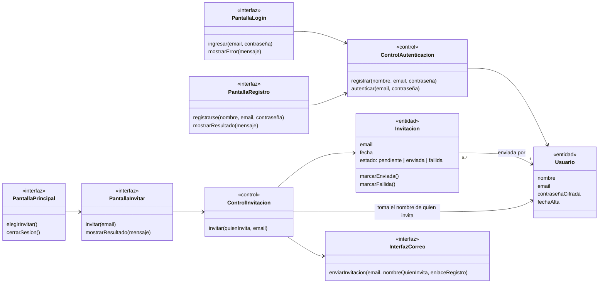
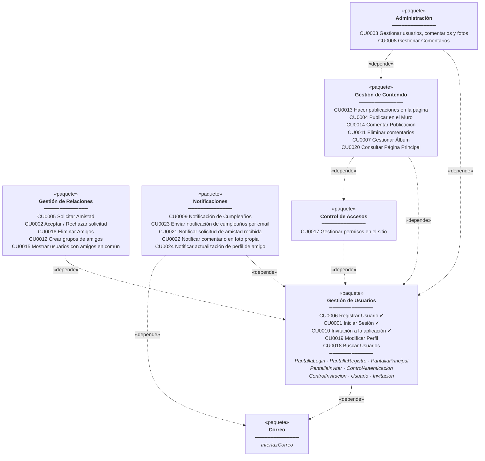

# ANÁLISIS — UMBook

**Versión:** 2.1 · **Última modificación:** 25/11/2026 · **Etapa:** Análisis

Análisis de los tres casos de uso implementados: **CU0001 Iniciar Sesión, CU0006 Registrar Usuario y CU0010 Invitación a la aplicación**. Los códigos son los de [`CATALOGO_CASOS_DE_USO_UMBook.md`](./CATALOGO_CASOS_DE_USO_UMBook.md) y los actores, los de `1. Requerimientos/2_Lista de Actores y CU.docx`.

Las clases de análisis y los paquetes se escriben en Mermaid dentro de este documento y se generan con `docs/generar_diagramas.py`; las colaboraciones, con `docs/generar_colaboraciones.py` (§5). **Si la imagen y este texto difieren, manda este texto** y hay que volver a generar la imagen.

## Qué hay en `2. Análisis/`

| Archivo | Qué es | Origen |
|---|---|---|
| `1_Diagrama de Clases de Análisis.png` | Clases de toda la aplicación, sin estereotipos | Grupo (marcado OK por la cátedra). Se conserva; ver §3.1 |
| `1_Diagrama de Clases de Análisis - Casos implementados.png` | Clases de análisis de CU0001, CU0006 y CU0010, con estereotipos | Este documento, §3 |
| `2_Diagrama de Paquetes.png` | Paquetes de análisis de toda la aplicación | Versión del grupo corregida, §4. La original está en `_version_anterior/` |
| `3_Diagramas de Colaboración/` | Una colaboración por caso implementado, con los íconos de análisis y mensajes numerados (.png y .svg) | `docs/generar_colaboraciones.py`, §5 |
| `4_Diagrama de paquetes y colaboracion.docx` | Colaboraciones del grupo para todos los casos de uso | Grupo. Para los tres casos implementados mandan las de `3_Diagramas de Colaboración/` (§5.4) |

---

## 1. Decisiones de análisis

| # | Decisión | Por qué |
|---|---|---|
| 1 | **No hay una entidad `Sesion`.** La sesión es un token firmado que viaja con cada pedido; el servidor no la guarda. | El código no persiste sesiones. Cerrar sesión borra el token del navegador. |
| 2 | **`Invitacion` es una entidad.** Se crea antes de enviar el correo y guarda el resultado (pendiente, enviada o fallida). | Lo pide el modelo de dominio y permite saber qué invitaciones fallaron (CU0010, ca 5.1). |
| 3 | **El servidor de correo es un actor externo**, y se le habla a través de una clase de interfaz (`InterfazCorreo`). | El correo sale del sistema: es frontera, no lógica ni dato. |
| 4 | **El invitado se identifica por su email**, no por un `Usuario`. | Quien recibe la invitación todavía no tiene cuenta. |
| 5 | **No hay una entidad `Notificacion`** en esta versión. | Los avisos (CU0009, CU0021, CU0022 y CU0024) no están implementados; la invitación es un correo, no una notificación dentro de la aplicación. |

---

## 2. Clases de análisis

| Estereotipo | Clase | Responsabilidad | Código que la realiza |
|---|---|---|---|
| Interfaz | `PantallaLogin` | Pedir email y contraseña; mostrar el error; guardar el token | `login.component` |
| Interfaz | `PantallaRegistro` | Pedir nombre, email y contraseña; mostrar el resultado | `register.component` |
| Interfaz | `PantallaPrincipal` | Saludar al usuario; ofrecer "Invitar amigos" y "Cerrar sesión" | `welcome.component` |
| Interfaz | `PantallaInvitar` | Pedir el email del invitado; mostrar la confirmación o el error | `invite.component` |
| Interfaz | `InterfazCorreo` | Armar el correo de invitación (con el enlace de registro) y entregarlo al servidor de correo | `NotificationService` (Flask-Mail) |
| Control | `ControlAutenticacion` | Registrar y autenticar usuarios | `auth_controller` + `AuthService` |
| Control | `ControlInvitacion` | Registrar la invitación, pedir el envío y guardar el resultado | `invite_controller` + `InvitationService` |
| Entidad | `Usuario` | Datos de la cuenta | `User` (tabla `users`) |
| Entidad | `Invitacion` | Invitación enviada por un usuario, con su estado | `Invitation` (tabla `invitations`) |

### Trazabilidad: caso de uso → clases

| Caso de uso | Actor | Interfaz | Control | Entidad |
|---|---|---|---|---|
| CU0001 Iniciar Sesión | Usuario Registrado | PantallaLogin | ControlAutenticacion | Usuario |
| CU0006 Registrar Usuario | Usuario No Registrado | PantallaRegistro | ControlAutenticacion | Usuario |
| CU0010 Invitación a la aplicación | Usuario Autenticado; Servidor de correo (secundario) | PantallaPrincipal, PantallaInvitar, InterfazCorreo | ControlInvitacion | Usuario, Invitacion |

---

## 3. Diagrama de clases de análisis (casos implementados)

<!-- png: 2. Análisis/1_Diagrama de Clases de Análisis - Casos implementados.png -->

Las interfaces de pantalla solo hablan con un control; los controles son los únicos que tocan las entidades y la interfaz del correo.

### 3.1 El diagrama del grupo (`1_Diagrama de Clases de Análisis.png`)

Cubre **toda la aplicación** (álbumes, muro, grupos, permisos, administración) y por eso se conserva. Tres puntos difieren de lo implementado; para los tres casos de uso implementados manda el diagrama de §3:

| En el diagrama del grupo | En lo implementado (§3) |
|---|---|
| `Usuario.invitarAmigo(usuario: Usuario)` | Se invita a un **email**: el invitado no tiene cuenta todavía (decisión 4). La operación es `ControlInvitacion.invitar(quienInvita, email)` |
| `Usuario` tiene `apellido` y `usuario` | `Usuario` tiene nombre, email y contraseña cifrada (CU0006 pide solo esos tres datos) |
| No hay operación de iniciar sesión ni clase `Invitacion` | `ControlAutenticacion.autenticar(...)` y la entidad `Invitacion` |

---

## 4. Diagrama de paquetes

Mantiene los paquetes del diagrama del grupo y corrige tres cosas: **Invitación a la aplicación** pasa a *Gestión de Usuarios* (como dicen las fichas de CU0010), se agrega **Iniciar Sesión** y **Solicitud de amistad** queda en un solo paquete. Se agregan *Administración* (CU0003 y CU0008 no tenían paquete) y *Correo*, que comparten Usuarios y Notificaciones; así no hay ciclos.

<!-- png: 2. Análisis/2_Diagrama de Paquetes.png -->

✔ = implementado. En cursiva, las clases de análisis de §2.

**Dependencias:** todos los paquetes usan a los usuarios. *Gestión de Usuarios* depende solo de *Correo* (para la invitación) y *Correo* no depende de nadie: **no hay ciclos**.

---

## 5. Diagramas de colaboración

Se dibujan con los **íconos del Proceso Unificado**: interfaz (círculo con una barra a la izquierda), control (círculo con una flecha) y entidad (círculo con una línea debajo). Cada enlace lleva sus mensajes numerados en el orden del curso normal de la ficha, con una flecha que indica el sentido. Los cursos alternativos se anotan al pie y se detallan en los diagramas de secuencia de Diseño.

Los genera `docs/generar_colaboraciones.py` (SVG, que se convierte a PNG); **los mensajes de este texto y los del script tienen que coincidir**.

### 5.1 CU0001 — Iniciar Sesión

`2. Análisis/3_Diagramas de Colaboración/CU0001 - Iniciar Sesión.png`

| Nº | De → a | Mensaje | Paso de la ficha |
|---|---|---|---|
| 1 | Usuario Registrado → PantallaLogin | ingresar(email, contraseña) | 3 |
| 2 | PantallaLogin → ControlAutenticacion | autenticar(email, contraseña) | 4 |
| 3 | ControlAutenticacion → Usuario | buscarPorEmail(email) | 5 |
| 4 | ControlAutenticacion → Usuario | verificarContraseña(contraseña) | 5 |
| 5 | ControlAutenticacion → PantallaLogin | token de sesión y nombre | 6 |
| 6 | PantallaLogin → PantallaPrincipal | guardarToken() y mostrar(nombre) | 7 |

ca 4.1 y ca 5.1: el mensaje 5 devuelve el error y PantallaLogin lo muestra; no se emite token.

### 5.2 CU0006 — Registrar Usuario

`2. Análisis/3_Diagramas de Colaboración/CU0006 - Registrar Usuario.png`

| Nº | De → a | Mensaje | Paso de la ficha |
|---|---|---|---|
| 1 | Usuario No Registrado → PantallaRegistro | registrarse(nombre, email, contraseña) | 3 y 4 |
| 2 | PantallaRegistro → ControlAutenticacion | registrar(nombre, email, contraseña) | 5 |
| 3 | ControlAutenticacion → Usuario | existeEmail(email) | 6 |
| 4 | ControlAutenticacion → Usuario | crear(nombre, email, contraseñaCifrada) | 6 |
| 5 | ControlAutenticacion → PantallaRegistro | cuenta creada | 7 |
| 6 | PantallaRegistro → Usuario No Registrado | informar(cuenta creada) | 7 |
| 7 | PantallaRegistro → PantallaLogin | mostrar() | 7 |

ca 5.1 y ca 6.1: el mensaje 5 devuelve el error (datos inválidos o email registrado) y no se crea el usuario.

### 5.3 CU0010 — Invitación a la aplicación

`2. Análisis/3_Diagramas de Colaboración/CU0010 - Invitación a la aplicación.png`

| Nº | De → a | Mensaje | Paso de la ficha |
|---|---|---|---|
| 1 | Usuario Autenticado → PantallaPrincipal | elegirInvitar() | 1 |
| 2 | PantallaPrincipal → PantallaInvitar | mostrar() | 2 |
| 3 | Usuario Autenticado → PantallaInvitar | invitar(email) | 3 |
| 4 | PantallaInvitar → ControlInvitacion | invitar(quienInvita, email) | 4 |
| 5 | ControlInvitacion → Usuario | obtenerNombre() | 5 |
| 6 | ControlInvitacion → Invitacion | crear(email) [pendiente] | 5 |
| 7 | ControlInvitacion → InterfazCorreo | enviarInvitacion(email, nombre, enlace) | 5 |
| 8 | InterfazCorreo → Servidor de correo | enviar correo | 5 |
| 9 | ControlInvitacion → Invitacion | marcarEnviada() | 6 |
| 10 | ControlInvitacion → PantallaInvitar | invitación enviada | 6 |
| 11 | PantallaInvitar → Usuario Autenticado | mostrar confirmación | 6 |

ca 4.1: email inválido, no se crea la invitación. ca 5.1: si falla el envío (8), el mensaje 9 es `marcarFallida()` y se avisa del fallo.

### 5.4 Las colaboraciones del `.docx` del grupo

`4_Diagrama de paquetes y colaboracion.docx` tiene las colaboraciones del grupo para todos los casos de uso. Para los tres implementados **mandan las de esta sección**, porque las del grupo difieren del código:

| Caso | Diferencia en la versión del grupo |
|---|---|
| Registrar Usuario | Estereotipos invertidos ("Gestor Usuario" como entidad y "Usuario" como control), el actor no está conectado y los mensajes no están numerados |
| Invitación a la Aplicación | El actor "selecciona amigo" (en realidad escribe un email), usa una entidad `Notificación` que no existe y los mensajes no están numerados. La entidad `Invitación` sí coincide |
| Iniciar Sesión | No tiene colaboración |

---

## 6. Teoría para la defensa

- **Para qué sirve el flujo de Análisis:** pasa de *qué hace el sistema* (casos de uso) a *qué objetos lo realizan*, todavía sin decidir cómo se programan.
- **Por qué tres estereotipos:** la interfaz cambia con la pantalla o con el sistema externo; el control concentra la lógica de un caso de uso; la entidad guarda los datos. Separarlos permite cambiar uno sin tocar los otros.
- **Por qué `InterfazCorreo` es interfaz y no control:** es la frontera con un actor externo (el servidor de correo), igual que una pantalla es la frontera con el usuario.
- **Qué agrega el Diseño:** convierte los controles en servicios y controllers de Flask, las entidades en modelos con su DAO, y `InterfazCorreo` en un `NotificationService` con el patrón Singleton. Ver `DISEÑO_UMBook.md`.

---

## Control del documento

| Versión | Fecha | Etapa / Chat | Cambios |
|---|---|---|---|
| 1.0 – 1.2 | 20/11/2026 – 25/11/2026 | Análisis | Análisis de la implementación anterior (amistad). Archivado en `_version_anterior/docs/` |
| 2.1 | 26/11/2026 | Análisis | Colaboraciones con los íconos del Proceso Unificado (interfaz, control, entidad), con tabla de mensajes y su paso de la ficha |
| 2.0 | 25/11/2026 | Análisis | Análisis de CU0001, CU0006 y CU0010: clases con estereotipos, paquetes corregidos con códigos, colaboración de CU0010 y actores de la lista |
