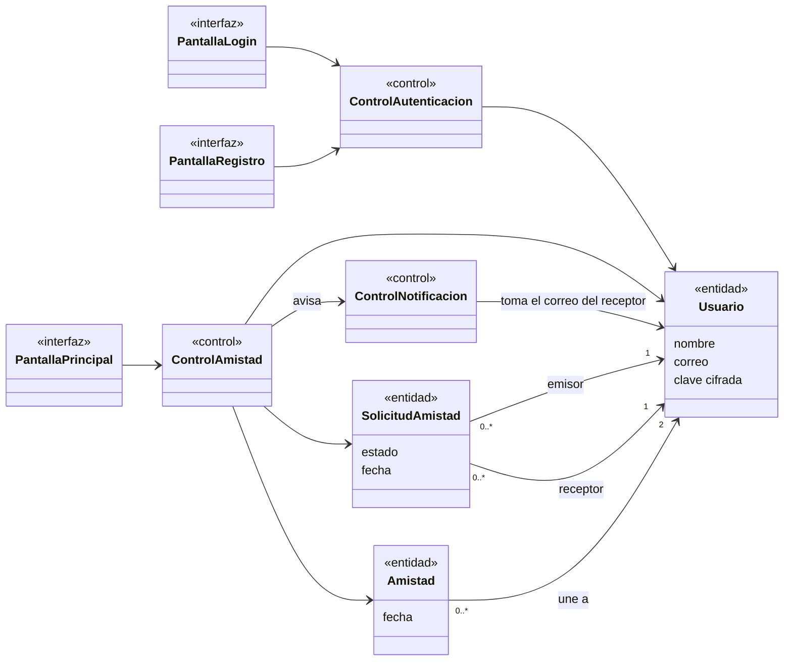
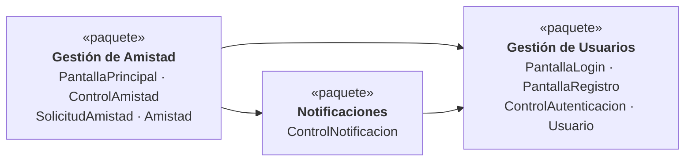
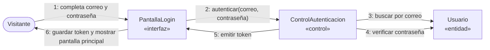
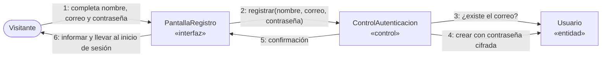
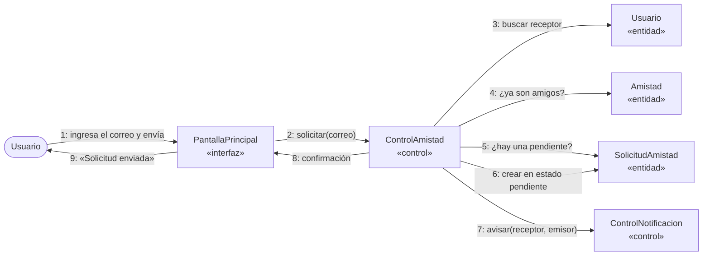
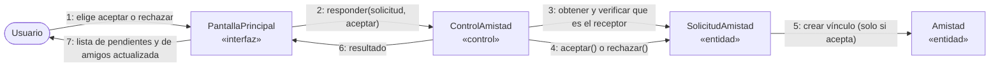
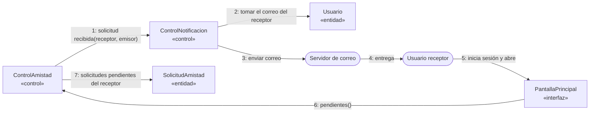

# ANÁLISIS — UMBook (casos implementados)

**Versión:** 1.0 · **Última modificación:** 20/11/2026 · **Etapa:** Análisis

Análisis de los cinco casos de uso implementados: CU0001 Iniciar Sesión, CU0006 Registrar Usuario, CU0011 Solicitar Amistad, CU0012 Aceptar / Rechazar Solicitud y CU0013 Notificar Solicitud Recibida. Los códigos están en [`CATALOGO_CASOS_DE_USO_UMBook.md`](./CATALOGO_CASOS_DE_USO_UMBook.md).

Los diagramas se escriben en Mermaid dentro de este documento, que es la fuente. Las imágenes `.png` de `2. Análisis/` se generan con `docs/generar_diagramas.py`. **Si el `.png` y este texto difieren, manda este texto** y hay que volver a generar la imagen.

---

## 1. Decisiones de análisis

| # | Decisión | Por qué |
|---|---|---|
| 1 | **No hay una entidad `Sesion`.** La sesión es un token firmado que viaja con cada pedido; el servidor no guarda nada. | El código no persiste sesiones. Cerrar sesión borra el token del navegador. |
| 2 | **No hay una entidad `Notificacion`.** El aviso en la aplicación es la lista de solicitudes pendientes del receptor. | Es la opción más simple y evita sincronizar dos estados. El único aviso con vida propia es el correo. |
| 3 | **`Amistad` es una entidad aparte de `SolicitudAmistad`.** | La solicitud tiene ciclo de vida (pendiente, aceptada, rechazada) y se conserva. La amistad es el vínculo confirmado, sin estado. |
| 4 | **El destinatario se identifica por correo.** | No se implementó la búsqueda de usuarios. |

---

## 2. Clases de análisis

| Estereotipo | Clase | Responsabilidad | Código que la realiza |
|---|---|---|---|
| Interfaz | `PantallaLogin` | Pedir correo y contraseña; mostrar el error; guardar el token | `login.component` |
| Interfaz | `PantallaRegistro` | Pedir nombre, correo y contraseña; mostrar el resultado | `register.component` |
| Interfaz | `PantallaPrincipal` | Mostrar amigos y solicitudes recibidas; pedir una solicitud nueva; responder | `welcome.component` |
| Control | `ControlAutenticacion` | Registrar y autenticar | `AuthService` |
| Control | `ControlAmistad` | Solicitar, responder, listar pendientes y amigos | `AmistadService` |
| Control | `ControlNotificacion` | Armar y enviar el correo de solicitud recibida | `NotificationService` |
| Entidad | `Usuario` | Datos de la cuenta | `Usuario` |
| Entidad | `SolicitudAmistad` | Pedido de amistad con su estado | `SolicitudAmistad` |
| Entidad | `Amistad` | Vínculo confirmado entre dos usuarios | `Amistad` |

### Trazabilidad: caso de uso → clases

| Caso de uso | Interfaz | Control | Entidad |
|---|---|---|---|
| CU0001 Iniciar Sesión | PantallaLogin | ControlAutenticacion | Usuario |
| CU0006 Registrar Usuario | PantallaRegistro | ControlAutenticacion | Usuario |
| CU0011 Solicitar Amistad | PantallaPrincipal | ControlAmistad, ControlNotificacion | Usuario, SolicitudAmistad, Amistad |
| CU0012 Aceptar / Rechazar | PantallaPrincipal | ControlAmistad | SolicitudAmistad, Amistad |
| CU0013 Notificar | PantallaPrincipal | ControlNotificacion, ControlAmistad | Usuario, SolicitudAmistad |

---

## 3. Diagrama de clases de análisis

<!-- png: 2. Análisis/Diagrama de Clases de Análisis.png -->

Las interfaces solo hablan con un control. Los controles son los únicos que tocan las entidades.

---

## 4. Diagrama de paquetes

<!-- png: 2. Análisis/Diagrama de paquetes.png -->

**Dependencias:** Gestión de Amistad usa a los usuarios (emisor y receptor) y pide los avisos. Notificaciones usa el correo del usuario. **Usuarios no depende de ningún otro paquete**: no hay ciclos.

---

## 5. Diagramas de colaboración

Los mensajes están numerados en el orden del curso normal. Los cursos alternativos se ven en el diagrama de secuencia de Diseño.

### 5.1 CU0001 — Iniciar Sesión

<!-- png: 2. Análisis/Diagramas de Colaboración/CU0001 - Iniciar Sesión.png -->

### 5.2 CU0006 — Registrar Usuario

<!-- png: 2. Análisis/Diagramas de Colaboración/CU0006 - Registrar Usuario.png -->

### 5.3 CU0011 — Solicitar Amistad

<!-- png: 2. Análisis/Diagramas de Colaboración/CU0011 - Solicitar Amistad.png -->

### 5.4 CU0012 — Aceptar / Rechazar Solicitud de Amistad

<!-- png: 2. Análisis/Diagramas de Colaboración/CU0012 - Aceptar - Rechazar Solicitud.png -->

### 5.5 CU0013 — Notificar Solicitud de Amistad Recibida

<!-- png: 2. Análisis/Diagramas de Colaboración/CU0013 - Notificar Solicitud Recibida.png -->

---

## 6. Teoría para la defensa

- **Para qué sirve el flujo de Análisis:** pasa de *qué hace el sistema* (casos de uso) a *qué objetos lo realizan*, todavía sin decidir cómo se programan.
- **Por qué tres estereotipos:** la interfaz cambia con la pantalla; el control concentra la lógica de un caso de uso; la entidad guarda los datos. Separarlos permite cambiar una sin tocar las otras.
- **Qué agrega el Diseño:** convierte `ControlAmistad` en un servicio que usa el patrón State y publica un evento (Observer); el aviso lo recibe un Singleton. Ver `DISEÑO_UMBook.md`.

---

## Control del documento

| Versión | Fecha | Etapa / Chat | Cambios |
|---|---|---|---|
| 1.0 | 20/11/2026 | Análisis | Versión inicial: clases y paquetes de análisis y cinco diagramas de colaboración |
