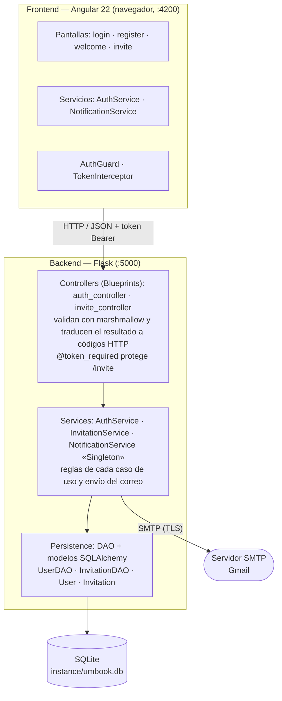

# DISEÑO — UMBook (casos implementados)

**Versión:** 2.0 · **Última modificación:** 26/11/2026 · **Etapa:** Diseño

Diseño de los tres casos de uso implementados (**CU0001 Iniciar Sesión, CU0006 Registrar Usuario y CU0010 Invitación a la aplicación**), tal como quedó **en el código** de `4. Implementacion/codigo/`. Los diagramas están en `3. Diseño/` (índice en `3. Diseño/README.md`); sus fuentes son los `.md` de cada carpeta y los scripts `docs/generar_*.py`. **Si una imagen y su texto difieren, manda el texto.**

> **Sobre `Diseño de Arquitectura - UMBook.docx`.** Es la propuesta de arquitectura del grupo y describe un sistema más grande que el implementado. Su sección final, "Estado de la implementación", compara elemento por elemento la propuesta con el código; la §8 de este documento lo resume.

La versión anterior de este documento, que describía la implementación de amistad (CU0011 a CU0013, patrones State y Observer), está en `_version_anterior/docs/DISEÑO_UMBook (amistad).md`.

---

## 1. Arquitectura en capas

<!-- sin entregable: la corrección no lo pide; el Mermaid queda como fuente -->

| Capa | Responsabilidad | Regla |
|---|---|---|
| Controllers | Validar el pedido con su esquema, llamar a un service y devolver la respuesta con su código | No contienen reglas del caso de uso |
| Services | Reglas de cada caso de uso: correo duplicado, hash y verificación de la clave, registro de la invitación y su estado, envío del correo | No conocen HTTP |
| Persistence | Consultas, altas y modelos | No contienen reglas |

`create_app()` (`app/__init__.py`) es el único lugar que arma las piezas: configuración, extensiones (`db`, `migrate`, `jwt`, `mail`, CORS) y Blueprints. Se niega a arrancar si `JWT_SECRET_KEY` falta o tiene un valor de ejemplo.

---

## 2. Estructura del código

**Backend** (rutas relativas a `4. Implementacion/codigo/backend/`):

| Ruta | Contiene |
|---|---|
| `run.py` | Punto de entrada: crea la app, crea las tablas que falten (`db.create_all()`) y escucha en `127.0.0.1:5000` |
| `app/__init__.py` | `create_app()` y las extensiones |
| `app/config.py` | Única fuente de configuración (lee `.env`) |
| `app/controllers/` | `auth_controller.py` (`RegisterSchema`, `LoginSchema`), `invite_controller.py` (`InviteSchema`) |
| `app/services/` | `auth_service.py`, `invitation_service.py`, `notification_service.py` |
| `app/persistence/` | `models.py` (`User`, `Invitation`) y `daos/` (`user_dao.py`, `invitation_dao.py`) |
| `app/utils/decorators.py` | `@token_required` |
| `tests/` | 33 pruebas de pytest: `test_auth.py`, `test_invite.py`, `test_seguridad.py` |

**Frontend** (rutas relativas a `4. Implementacion/codigo/frontend/src/app/`):

| Ruta | Contiene |
|---|---|
| `app.module.ts` | Rutas: `/login`, `/register`, `/welcome` e `/invite` (las dos últimas con `AuthGuard`); registra `TokenInterceptor` |
| `core/` | `auth.service.ts`, `notification.service.ts`, `auth.guard.ts`, `token.interceptor.ts` |
| `features/` | `LoginComponent`, `RegisterComponent`, `WelcomeComponent`, `InviteComponent` |

| Endpoint | Caso de uso | Requiere token |
|---|---|---|
| `POST /auth/register` | CU0006 | No |
| `POST /auth/login` | CU0001 | No |
| `POST /invite` | CU0010 | Sí (`@token_required`) |

---

## 3. Mecanismos de diseño

Los códigos de requisito son los de `docs/REQUISITOS_NO_FUNCIONALES_UMBook.md`.

| Mecanismo | Cómo se resuelve | Requisito |
|---|---|---|
| Autenticación | Token JWT firmado con `JWT_SECRET_KEY`, creado en `auth_controller.login`; vence a los 15 minutos (valor por defecto de Flask-JWT-Extended). `@token_required` lo valida y le pasa el usuario al endpoint como `current_user` | RNF-20 |
| Almacenamiento de claves | `generate_password_hash` / `check_password_hash` (Werkzeug), dentro de `AuthService` | RNF-09 |
| Mensaje único de error de acceso | `authenticate` devuelve `None` tanto si el correo no existe como si la clave no coincide; el controller responde siempre "Credenciales incorrectas." | RNF-18 |
| Validación de entrada | Esquemas de marshmallow en los controllers; el navegador repite las validaciones simples | RNF-19 |
| Persistencia | Flask-SQLAlchemy sobre SQLite; acceso solo a través de los DAO | RNF-16, RNF-25 |
| Integridad | Correo con restricción única en la base y normalizado (minúsculas, sin espacios) en `UserDAO` | RNF-23 |
| Transacciones | Cada operación del DAO confirma con `db.session.commit()`; la invitación se guarda antes del envío y su estado se actualiza después | — |
| Correo | Flask-Mail por SMTP con TLS (Gmail); `NotificationService` «Singleton» es el único que envía. `MAIL_SUPPRESS_SEND=true` desactiva el envío real para probar | RNF-17, RNF-25 |
| Fallo del correo | La invitación queda `fallida`, el detalle va al log y el cliente recibe un 500 con un mensaje genérico | RNF-22, RNF-24 |
| Configuración | Variables de entorno (`.env`, fuera del repositorio); la aplicación no arranca sin una clave JWT segura y el modo debug solo se activa con `FLASK_DEBUG=1` | RNF-21 |
| CORS | Flask-Cors, con `CORS_ORIGIN` configurable | — |
| Sesión en el cliente | Token y nombre en `localStorage`; `TokenInterceptor` agrega el token y cierra la sesión ante un 401; `AuthGuard` protege `/welcome` e `/invite` | RNF-20 |

| Respuesta | Código | Dónde |
|---|---|---|
| Datos inválidos (marshmallow) | 400 | `/auth/register`, `/auth/login`, `/invite` |
| Credenciales incorrectas | 401 | `/auth/login` |
| Token ausente, inválido o vencido | 401 | `/invite` (`@token_required`) |
| Correo ya registrado | 409 | `/auth/register` |
| Fallo del envío del correo | 500 | `/invite` |

Todas las respuestas de error llevan el mensaje en la clave `msg`.

---

## 4. Diagrama de clases de diseño

El diagrama está en [`3. Diseño/3_Diagramas de Clases/diseno-clases.md`](../3.%20Diseño/3_Diagramas%20de%20Clases/diseno-clases.md) (imagen `Diagrama de clases de diseño.png`), con cinco paquetes: presentación y servicios de Angular, controladores Flask, servicios y persistencia. Ese archivo explica cada clase, la notación y el recorrido de cada caso de uso.

### Dónde está cada patrón

| Patrón | Clases | Qué resuelve |
|---|---|---|
| **Singleton** | `NotificationService` (backend) | Una sola instancia envía todos los correos: `__new__` devuelve siempre la misma, creada con doble verificación y candado. |
| **DAO** | `UserDAO`, `InvitationDAO` | Los servicios no tocan `db.session`: las consultas y la normalización del correo quedan en un solo lugar. |
| **Decorator** | `@token_required` | La protección de un endpoint se agrega con una línea; la vista recibe el usuario y no sabe cómo se valida el token. |

### Lo que conviene poder explicar

- **Por qué la invitación se guarda antes de enviar el correo:** así el fallo del envío queda registrado (`fallida`) aunque el correo no salga, y se puede consultar qué invitaciones fallaron (CU0010, Ob 1).
- **Por qué el token lo crea el controller y no el servicio:** `AuthService` no conoce HTTP ni JWT; solo decide si las credenciales son válidas.
- **Por qué `AuthService` y `NotificationService` existen en el frontend y en el backend:** son clases distintas con el mismo nombre. Las de Angular hacen las llamadas HTTP; las de Flask tienen las reglas. El diagrama de clases las distingue por paquete.

---

## 5. Diagrama de despliegue

`3. Diseño/1_Diagrama de Despliegue.png` (y `.svg`), generado con `docs/generar_despliegue_subsistemas.py`. Mantiene la forma del diagrama del grupo (nodos en 3D con sus componentes, hecho originalmente en PlantUML) con el contenido del código actual. El original está en `_version_anterior/3. Diseño/`.

| Nodo | Componente | Qué hay en el código |
|---|---|---|
| Equipo local (127.0.0.1) | — | Agrupa los tres nodos locales: es un despliegue de **demostración**, todo en el mismo equipo. `run.py` hace que Flask escuche solo en `127.0.0.1` |
| Cliente Web | Navegador web · SPA Angular 22 | La aplicación Angular; el token de sesión queda en `localStorage` |
| Servidor Frontend | Node.js · `ng serve`, puerto 4200 | Servidor de desarrollo de Angular. `CORS_ORIGIN` y `FRONTEND_URL` apuntan a `http://localhost:4200` |
| Servidor Backend | Flask 3 · Python 3, API REST en el puerto 5000 · SQLite `instance/umbook.db` | Blueprints `/auth` e `/invite`. La base es un archivo dentro del mismo nodo, al que se accede con SQLAlchemy (no hay servidor de base de datos) |
| Servidor de Correo | Gmail (SMTP), `smtp.gmail.com:587` | Externo. Flask-Mail se conecta con TLS (`MAIL_USE_TLS=true`) y una *app password* del `.env` |

| Comunicación | Protocolo |
|---|---|
| Navegador → Servidor Frontend | HTTP: descarga la SPA |
| Navegador → Servidor Backend | HTTP / JSON, con `Authorization: Bearer <JWT>` en `/invite` |
| Flask → SQLite | SQLAlchemy (archivo local) |
| Flask → Gmail | SMTP + TLS (Flask-Mail) |

**Diferencias con el diagrama del grupo:** el backend es Flask, no Spring Boot; la base es SQLite por SQLAlchemy, no PostgreSQL/MySQL por JDBC; se agrega el nodo del frontend Angular, y la comunicación con el navegador es **HTTP**, no HTTPS (RNF-10 figura como no cumplido).

---

## 6. Diagrama de subsistemas

`3. Diseño/2_Diagrama de Subsistemas.png` (y `.svg`), generado con `docs/generar_despliegue_subsistemas.py`. Mantiene las cuatro capas y la forma del diagrama del grupo; el original está en `_version_anterior/3. Diseño/`.

| Capa | Subsistemas | Relación con el código |
|---|---|---|
| Aplicación Específica | **Gestión de Usuarios** «implementado» (CU0001, CU0006, CU0010) · Gestión de Relaciones · Gestión de Contenido · Notificaciones · Control de Accesos · Administración | Son los paquetes de Análisis (`docs/ANALISIS_UMBook.md` §4). Solo Gestión de Usuarios tiene código; el resto son los casos de uso sin implementar |
| Aplicación General | Autenticación y Seguridad · Gestión de Correos · Persistencia · Validación de Datos | JWT, hash de claves y `@token_required`; `NotificationService` «Singleton»; DAO sobre SQLAlchemy; esquemas marshmallow |
| Capa Intermedia | Flask 3 (Blueprints, Flask-CORS) · Flask-JWT-Extended · Flask-SQLAlchemy · Flask-Mail · marshmallow · Angular 22 (Router, HttpClient, RxJS) | `backend/requirements.txt` y `frontend/package.json` |
| Software del Sistema | Python 3 · Node.js · SQLite · Navegador web · HTTP, SMTP/TLS | Lo que se instala para correr la aplicación |

Cada capa usa solo a las de abajo. El paquete *Correo* de Análisis corresponde a **Gestión de Correos**, en Aplicación General, porque lo comparten Usuarios y Notificaciones.

**Diferencias con el diagrama del grupo:** se quitan Spring Boot Framework, REST Controllers (de Spring), Android/iOS y Drivers JDBC, que no se usan; se quitan Gestión de Sesiones y Auditoría y Logs, que no existen como subsistemas (la sesión es el JWT, dentro de Autenticación y Seguridad); se agregan Control de Accesos y Administración para que coincida con los paquetes de Análisis.

---

## 7. Secuencia y estados

Los diagramas de secuencia por caso de uso están en `3. Diseño/4_Diagramas de Secuencia/` y el de estados en `3. Diseño/5_Diagramas de Estado/`. El índice está en `3. Diseño/README.md`.

| Caso de uso | Diagrama |
|---|---|
| CU0001 Iniciar Sesión | `CU0001 - Iniciar Sesión.png` (fuente `login-secuencia.md`) |
| CU0006 Registrar Usuario | `CU0006 - Registrar Usuario.png` (fuente `registro-secuencia.md`) |
| CU0010 Invitación a la aplicación | `CU0010 - Invitación a la aplicación.png` (fuente `invitacion-secuencia.md`) |
| Estados de Invitación y de la sesión del usuario | `Diagramas de Estado.png` (fuente `estados.md` y `docs/generar_estados.py`) |

Las secuencias siguen la estética de las de la compañera y los estados, la forma del PDF del grupo. Los de amistad (CU0011 a CU0013 y `SolicitudAmistad`) están en `_version_anterior/3. Diseño/`.

---

## 8. Diferencias con `Diseño de Arquitectura - UMBook.docx`

El detalle, elemento por elemento, está en la sección "Estado de la implementación" del propio documento (`3. Diseño/6_Propuesta de Arquitectura/`). En resumen:

| La propuesta decía | Lo implementado |
|---|---|
| Controladores con Flask (Blueprints) o FastAPI | Flask con Blueprints (`/auth`, `/invite`) |
| Validación con pydantic o marshmallow | marshmallow |
| Capas: presentación, controladores, servicios, persistencia, infraestructura | Angular → controller → service → DAO → modelo; la infraestructura (correo) vive en `NotificationService` |
| SQLAlchemy + Alembic | SQLAlchemy sí; Alembic no: no hay migraciones, las tablas se crean con `db.create_all()` |
| Manejo global de errores | No: cada endpoint traduce sus errores |
| Singleton (`Notificador`) | ✅ `NotificationService` |
| Observer, Composite, Factory Method, Strategy | ❌ No implementados: pertenecen a eventos, álbumes, comentarios y permisos, que no están en el código. La propuesta usaba Factory Method para la Invitación; el código la crea directamente en `InvitationDAO.create` |
| DAO y Decorator | No figuraban como patrones; se usan (`UserDAO`, `InvitationDAO`, `@token_required`) |
| `UsuarioService`, `NotificacionService` | `AuthService`, `NotificationService` |
| `JwtTokenProvider`, `SecurityConfig`, `AuthFilter` | Las funciones de Flask-JWT-Extended y el decorador `@token_required`; no hay roles |
| Subsistemas "Android y iOS", "Drivers JDBC", "Gestión de Sesiones", "Auditoría y Logs" | No aplican (ver §6) |
| DAO y servicios de amistad, álbum, foto y comentario | No existen |

---

## 9. Hallazgos de diseño

Numeración continua con la versión anterior (H1 a H5 eran de amistad y quedaron en `_version_anterior/docs/DISEÑO_UMBook (amistad).md`).

| # | Hallazgo | Dónde | Estado |
|---|---|---|---|
| H6 | **`AuthGuard` no detecta el token vencido:** `isAuthenticated()` solo mira si hay token guardado, así que con el token vencido se abren `/welcome` e `/invite` hasta la primera petición, que responde 401 y cierra la sesión. | `auth.guard.ts`, `auth.service.ts` | Aceptado: el backend nunca acepta el token vencido. Documentado en el diagrama de estados de la sesión |
| H7 | **Sin timeout en el envío del correo:** Flask-Mail 0.9.1 abre la conexión con `smtplib.SMTP(servidor, puerto)`, sin timeout. Si el servidor de correo no responde, la petición `/invite` queda esperando y no se garantiza el rnf 2.2 de CU0010 (menos de 5 segundos). | `notification_service.py` (vía Flask-Mail) | Anotado, no reproducido |
| H8 | **Registro simultáneo con el mismo correo:** `register_user` primero busca y después inserta. Si dos pedidos llegan a la vez, la restricción única de la base impide el duplicado, pero el `IntegrityError` no se atrapa y la respuesta es 500 en lugar de 409. | `auth_service.py`, `user_dao.py` | Anotado, no reproducido (requiere dos pedidos simultáneos) |
| H9 | **Dos convenciones de resultado en `AuthService`:** `register_user` devuelve una tupla `(User, error)` y `authenticate` devuelve `User` o `None`. El texto del error (`'Email already registered'`) no se usa: el controller muestra su propio mensaje. | `auth_service.py` | Anotado |
| H10 | **Dirección del backend fija en el frontend:** `AuthService` y `NotificationService` de Angular usan `http://localhost:5000` en el código, sin un archivo de entorno. | `core/auth.service.ts`, `core/notification.service.ts` | Anotado: alcanza para el despliegue de demostración |
| H11 | **Sin migraciones:** `db.create_all()` crea las tablas que faltan pero no modifica las existentes; cambiar una columna obliga a recrear la base local. | `run.py` | Anotado (ver §8) |

---

## Control del documento

| Versión | Fecha | Etapa / Chat | Cambios |
|---|---|---|---|
| 2.0 | 26/11/2026 | Diseño | Documento realineado con el código actual (CU0001, CU0006, CU0010): capas, estructura, mecanismos con los RNF vigentes, patrones Singleton, DAO y Decorator, diferencias con la propuesta y hallazgos H6 a H11. Se quita el aviso de desactualizado. La versión de amistad pasa a `_version_anterior/docs/` |
| 1.3 | 26/11/2026 | Diseño | §4 remite al diagrama de clases de diseño del código actual; el de amistad deja de regenerarse y pasa a `_version_anterior/`. §5 y §6: despliegue y subsistemas rehechos con el código actual, con la forma de los del grupo. §7: secuencias y estados del código actual |
| 1.2 | 25/11/2026 | Diseño | Rutas numeradas según la corrección de la cátedra. Capas, despliegue, subsistemas y estados se entregan en la versión del grupo y dejan de regenerarse; el diagrama de clases de diseño integral pasa a `3_Diagramas de Clases/` |
| 1.1 | 25/11/2026 | Diseño | H1, H2 y H5 (nuevo) resueltos: índice único parcial en `SolicitudAmistad`, control de solicitud cruzada y tolerancia a fallos del correo. Se actualizan los diagramas de secuencia de CU0011 y CU0013 y las notas del diagrama de estados |
