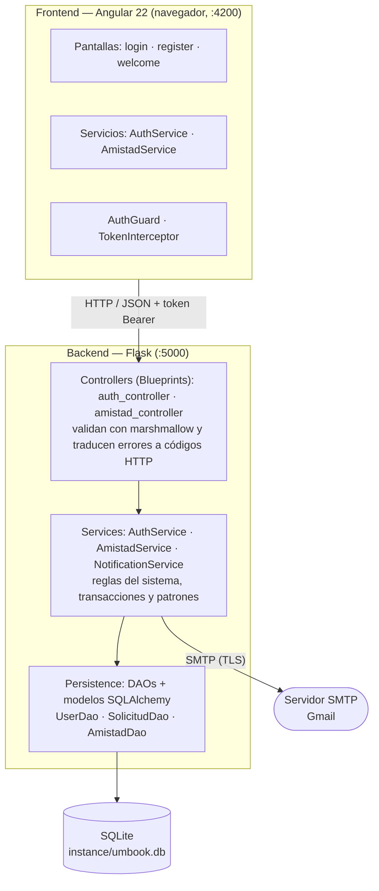
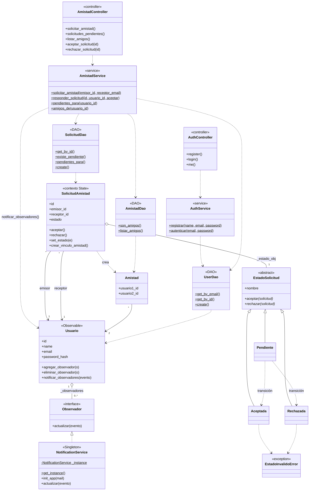
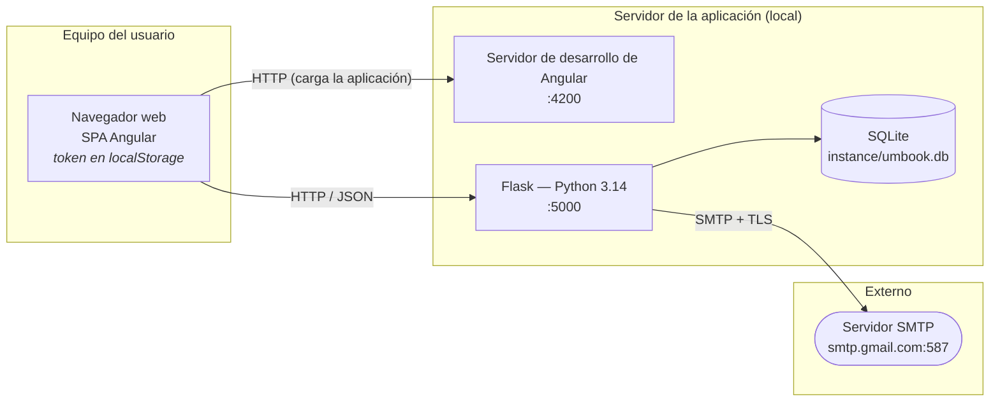
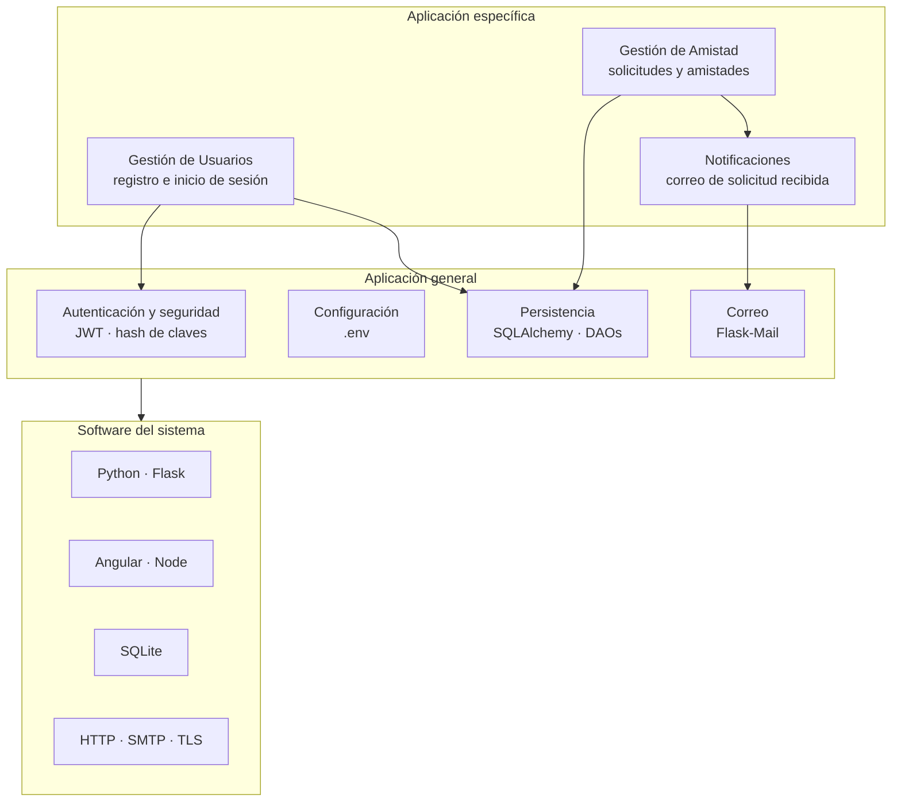

# DISEÑO — UMBook (casos implementados)

**Versión:** 1.0 · **Última modificación:** 20/11/2026 · **Etapa:** Diseño

Diseño de los cinco casos de uso implementados (CU0001, CU0006, CU0011, CU0012 y CU0013), tal como quedó **en el código**. Los diagramas están en Mermaid dentro de este documento y de los archivos de `3. Diseño/Diagramas de …/`, que son la fuente. Las imágenes `.png` se generan con `docs/generar_diagramas.py`. **Si el `.png` y el texto difieren, manda el texto.**

> **Sobre `Diseño de Arquitectura - UMBook.docx`.** Es la propuesta de arquitectura original del grupo y describe un sistema más grande que el que se implementó (Spring, FastAPI, Android e iOS, JDBC, y los patrones Composite, Factory Method y Strategy). Para los casos implementados **manda este documento**; la §8 lista las diferencias.

---

## 1. Arquitectura en capas

<!-- png: 3. Diseño/Diagrama de capas.png -->

| Capa | Responsabilidad | Regla |
|---|---|---|
| Controllers | Validar el pedido, llamar a un service y devolver la respuesta con su código | No contienen reglas del sistema |
| Services | Reglas del sistema, patrones State y Observer, `commit` y `rollback` | No conocen HTTP |
| Persistence | Consultas y modelos | No contienen reglas |

`create_app()` (`app/__init__.py`) es el único lugar que arma las piezas: configuración, extensiones y blueprints.

---

## 2. Estructura del código

Las rutas son relativas a `4. Implementacion/codigo/backend/`.

| Ruta | Contiene |
|---|---|
| `run.py` | Punto de entrada: crea la app, las tablas y arranca el servidor |
| `app/config.py` | Única fuente de configuración (lee `.env`) |
| `app/extensions.py` | Instancias de SQLAlchemy, Migrate, JWT, Mail y CORS |
| `app/controllers/` | `auth_controller.py`, `amistad_controller.py` |
| `app/services/` | `auth_service.py`, `amistad_service.py`, `notification_service.py`, `observer.py`, `estados/estado_solicitud.py` |
| `app/persistence/` | `models.py` y `daos/` (`user_dao.py`, `solicitud_dao.py`) |
| `app/templates/emails/` | Plantillas del correo (HTML y texto) |
| `app/utils/decorators.py` | `@token_required` |
| `tests/` | 32 pruebas de pytest |

| Endpoint | Caso de uso |
|---|---|
| `POST /auth/login` | CU0001 |
| `POST /auth/register` | CU0006 |
| `POST /amistad/solicitudes` | CU0011 (dispara CU0013) |
| `GET /amistad/solicitudes/pendientes` | CU0012 (paso 1) y CU0013 (paso 5) |
| `POST /amistad/solicitudes/<id>/aceptar` · `…/rechazar` | CU0012 |
| `GET /amistad/amigos`, `GET /auth/me` | Apoyo de la pantalla principal |

---

## 3. Mecanismos de diseño

| Mecanismo | Cómo se resuelve | Requisito |
|---|---|---|
| Autenticación | Token JWT firmado con `JWT_SECRET_KEY`; `@token_required` lo valida y deja el usuario en `g.current_user` | RNF-16 |
| Almacenamiento de claves | `generate_password_hash` / `check_password_hash` (Werkzeug) | RNF-08 |
| Validación de entrada | Esquemas de marshmallow en los controllers | RNF-14 |
| Persistencia | Flask-SQLAlchemy sobre SQLite | RNF-06 |
| Integridad | Restricciones únicas: correo, par emisor-receptor, par de amigos | RNF-15 |
| Transacciones | `db.session.commit()` único en `responder_solicitud`, con `rollback` ante cualquier excepción | RNF-12 |
| Correo | Flask-Mail, plantillas Jinja en HTML y texto; `MAIL_SUPPRESS_SEND` para pruebas | RNF-02 |
| Configuración | Variables de entorno (`.env`, fuera del repositorio) | RNF-18 |
| CORS | Flask-Cors, con `CORS_ORIGIN` configurable | — |
| Errores | Cada excepción del dominio se traduce a un código HTTP en el controller | ver tabla siguiente |
| Sesión en el cliente | `TokenInterceptor` cierra la sesión ante 401 o 422; `AuthGuard` protege la pantalla principal | RNF-10, RNF-16 |

| Excepción | Código | Dónde |
|---|---|---|
| Validación de marshmallow | 400 | Todos los endpoints con cuerpo |
| `CredencialesInvalidasError` | 401 | login |
| `NoAutorizadoError` | 403 | aceptar / rechazar |
| `UsuarioNoEncontradoError`, `SolicitudNoEncontradaError` | 404 | solicitar, aceptar / rechazar |
| `EmailYaRegistradoError`, `SolicitudInvalidaError`, `EstadoInvalidoError` | 409 | registro, solicitar, aceptar / rechazar |

---

## 4. Diagrama de clases de diseño (integral)

Un solo diagrama con los tres patrones. Los diagramas parciales están en `3. Diseño/Diagramas de Clases/`.

<!-- png: 3. Diseño/Diagrama de clases de diseño.png -->

### Dónde está cada patrón

| Patrón | Clases | Qué resuelve |
|---|---|---|
| **State** | `SolicitudAmistad` (contexto), `EstadoSolicitud`, `Pendiente`, `Aceptada`, `Rechazada` | Que cada estado decida qué transiciones admite. `aceptar()` y `rechazar()` de la solicitud solo delegan. Agregar un estado no obliga a tocar el servicio. |
| **Observer** | `Usuario` (observable), `Observador` | Que `AmistadService` avise de la solicitud sin conocer a quien reacciona. |
| **Singleton** | `NotificationService` | Una sola instancia del notificador, con doble verificación y candado. |

### Lo que conviene poder explicar

- **`Usuario` ↔ `NotificationService`:** el modelo registra al notificador como observador por defecto y lo importa dentro del método, no al principio del archivo, para evitar un import circular entre modelos y servicios.
- **`estado` y `_estado_obj`:** el primero es el texto que se guarda en la base; el segundo es el objeto State, que no se guarda y se reconstruye al cargar la fila.
- **Orden canónico de `Amistad`:** el id menor va primero, para que la restricción única y `son_amigos()` no dependan de quién envió la solicitud.

---

## 5. Diagrama de despliegue

<!-- png: 3. Diseño/Diagrama de despliegue.png -->

| Nodo | Qué hay |
|---|---|
| Navegador | La aplicación Angular y el token de sesión |
| Servidor local | Flask (API), la base SQLite y el servidor de desarrollo de Angular |
| Servidor de correo | Gmail, con una *app password* en `.env` |

Es un despliegue de **demostración**: servidores de desarrollo en un equipo local, sin servidor de producción.

---

## 6. Diagrama de subsistemas

<!-- png: 3. Diseño/Diagrama de subsistemas.png -->

---

## 7. Secuencia y estados

Los diagramas de secuencia por caso de uso están en `3. Diseño/Diagramas de Secuencia/` y el de estados en `3. Diseño/Diagramas de Estado/`. El índice está en `3. Diseño/README.md`.

| Caso de uso | Diagrama |
|---|---|
| CU0001 Iniciar Sesión | `CU0001 - Iniciar Sesión.png` |
| CU0006 Registrar Usuario | `CU0006 - Registrar Usuario.png` |
| CU0011 Solicitar Amistad | `CU0011 - Solicitar Amistad.png` |
| CU0012 Aceptar / Rechazar | `CU0012 - Aceptar - Rechazar Solicitud.png` |
| CU0013 Notificar | `CU0013 - Notificar Solicitud Recibida.png` |
| Estados de `SolicitudAmistad` | `Diagrama de Estados - SolicitudAmistad.png` |

---

## 8. Diferencias con `Diseño de Arquitectura - UMBook.docx`

| La propuesta decía | Lo implementado |
|---|---|
| Controladores "Spring `@RestController`", o FastAPI | Flask con Blueprints |
| Validación con pydantic o marshmallow | marshmallow |
| Capas: presentación, controladores, servicios, persistencia, infraestructura | controller → service → DAO → modelo; la infraestructura (correo) vive en `NotificationService` |
| Singleton (`Notificador`) | ✅ `NotificationService` |
| Observer (Usuario, Álbum y Muro como observables) | ✅ solo `Usuario` es observable |
| Composite, Factory Method, Strategy | ❌ no se implementaron: pertenecen a álbumes, comentarios y permisos |
| State | **No estaba en la propuesta**; se agregó para `SolicitudAmistad` |
| `SecurityConfig`, `AuthFilter`, `JwtTokenProvider` | Un decorador, `@token_required`, y Flask-JWT-Extended |
| Subsistema "Android y iOS" y "Drivers JDBC" | No aplican: es una aplicación web en Python |
| DAOs de álbum, foto y comentario | No existen |

---

## 9. Hallazgos de diseño

| # | Hallazgo | Dónde | Estado |
|---|---|---|---|
| H1 | **Volver a solicitar amistad a quien rechazó una solicitud devuelve 500.** La restricción única `(emisor_id, receptor_id)` impide una segunda fila, y `existe_pendiente` solo mira las pendientes. Se verificó con una prueba manual: la primera solicitud responde 201, el rechazo 200 y el reenvío 500. | `models.py`, `solicitud_dao.py` | **Abierto.** Opciones: permitir reabrir la solicitud rechazada, o devolver 409 con un mensaje claro. |
| H2 | El correo se envía de forma síncrona dentro de la petición que crea la solicitud: si el servidor SMTP falla, falla toda la petición. | `amistad_service.py`, `notification_service.py` | Abierto |
| H3 | `NotificationService` conserva `enviar_email` y `notificar`, que sobraron de un caso de invitaciones que no se implementó. | `notification_service.py` | Anotado |
| H4 | `Usuario` conoce a `NotificationService` (import diferido): un modelo depende de un servicio. | `models.py` | Aceptado; se documenta para la defensa |

---

## Control del documento

| Versión | Fecha | Etapa / Chat | Cambios |
|---|---|---|---|
| 1.0 | 20/11/2026 | Diseño | Versión inicial: capas, mecanismos, clases integral, despliegue, subsistemas y diferencias con la propuesta original |
