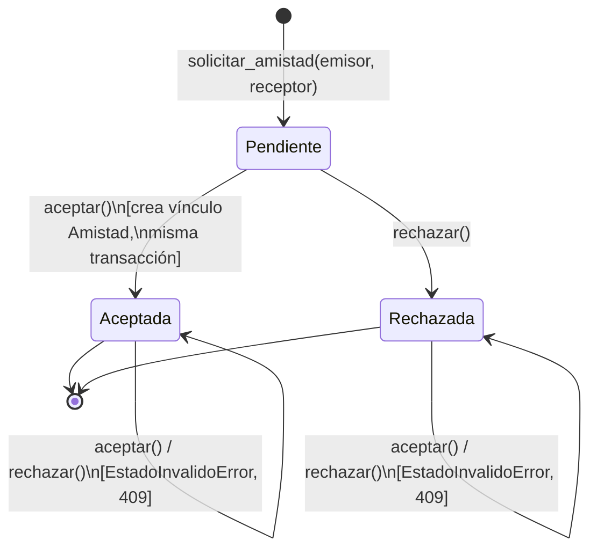

# Solicitar Amistad / Aceptar-Rechazar — Diagrama de estados

`Aceptada` y `Rechazada` son estados terminales: cualquier transición nueva desde
ahí es inválida (`EstadoInvalidoError`, 409 en la API). No hay forma de volver a
`Pendiente` ni de pasar de un estado terminal a otro.

**Guardas que se evalúan antes de siquiera llegar a `Pendiente`** (en
`AmistadService.solicitar_amistad`, no en el patrón State — son reglas de
creación, no de transición): receptor debe existir, emisor ≠ receptor, no debe
existir ya una amistad confirmada, no debe haber ya una solicitud pendiente para
el mismo par de usuarios.
