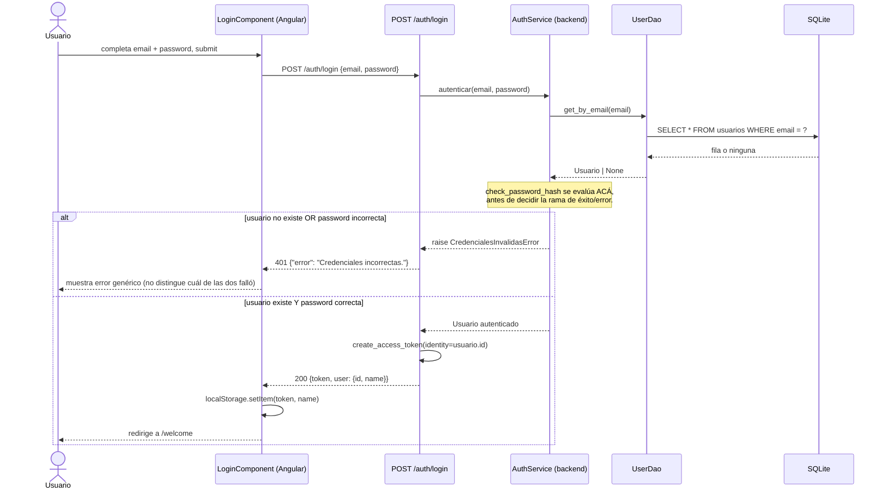

# Login — Diagrama de secuencia

Curso normal + los dos alternativos de CU0001, unificados en un solo `alt` para
mostrar el punto exacto del fix: `check_password_hash` se evalúa **antes** de
decidir la rama (a diferencia del diagrama original de la compañera, donde
aparecía adentro de la rama "éxito" — ver
[`../construccion.md` sección 1](../construccion.md#1-login--corrección-de-un-bypass-de-autenticación)).

**Curso alternativo de formato** (campos vacíos/inválidos) no llega a pegarle al
backend: `LoginSchema` de marshmallow lo valida en `POST /auth/login`, y el
frontend ya corta antes con el mismo mensaje si `email`/`password` vienen vacíos
(`LoginComponent.submit()`).
