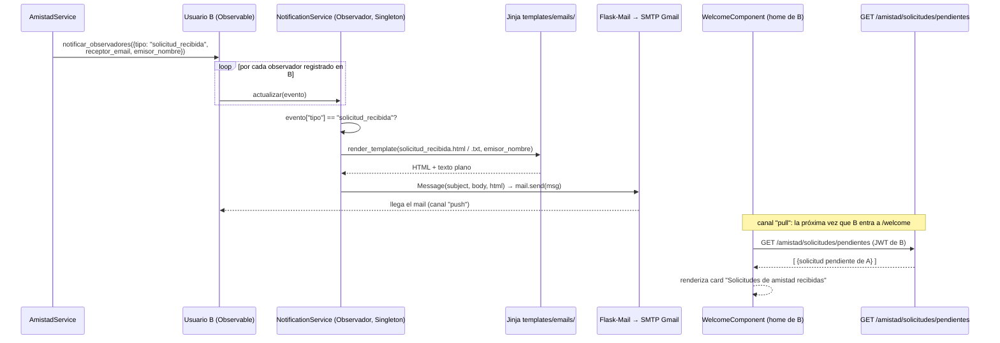

# Notificar Solicitud de Amistad Recibida — Diagrama de secuencia

Continúa exactamente donde termina
[`amistad-secuencia-solicitar.md`](./amistad-secuencia-solicitar.md): el punto
que hace válido el patrón es que `AmistadService` publica el evento en el
`Usuario` receptor y nunca llama al `NotificationService` directo.

**No hay entidad `Notificacion` separada** (decisión documentada en
[`../proyecto.md`](../proyecto.md)): el mail es la notificación "push" en tiempo
real, y la lista de `solicitudes/pendientes` es la notificación "pull" que ve la
home — la misma consulta que ya usa el CU de Solicitar Amistad.
